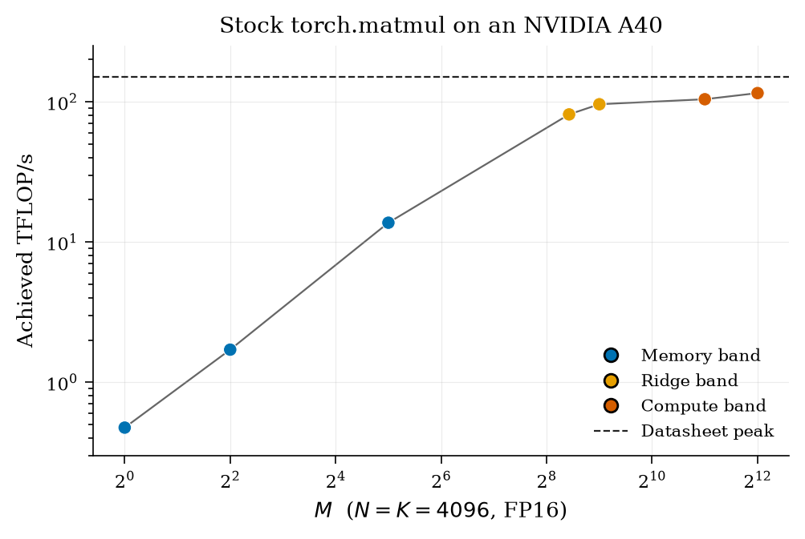

# Shape-Conditioned Intensity Classification for Plan-Polymorphic Operator Fusion

**Target venues:** MLSys or ASPLOS.
**Status:** draft. Analytical results are produced by this repository. The third NVIDIA A40 package is archived under `paper/data/a40/` (`PARTIAL_VENDOR_MATMUL`, `--machine A40_FP16`, datasheet ridge ≈ 215.09, M\* ≈ 240.3). It times `torch.matmul`, a fusion proxy, and a copy-kernel bandwidth estimate. `TRY_NSIGHT=1` found `ncu` on `PATH`; `ncu` then failed with `ERR_NVGPUCTRPERM` (`nsight_error.log`, `nsight_skipped.txt`). `achieved_ai` is still empty. `proxy_ai` is `TORCH_PROFILER_MEMORY_NOT_DRAM` (`quote_as_scic_accuracy` false). The copy-kernel file is `ESTIMATE_COPY_NOT_NSIGHT`; `measured_ridge_flops_per_byte` is null. Fused MemMode/ComputeMode kernels are not in that run. The Docker wall-clock bakeoff is archived under `paper/data/bakeoff/` (`BAKEOFF_WALLCLOCK`, `nsight_used` false) and quoted in §7.3. That archive is the selector **before** the library-SDPA epilogue fix. The second run, after `compile_sdpa_chain`, is archived under `paper/data/bakeoff_v2/` and quoted in the same section. It is also not an idle-GPU measurement: at script start physical GPU 1 was at 92% utilization with 13490 MiB allocated by other workloads (`RUN_NOTES.txt`, `gpu_selection.json`, `idle_found` false). The fourth run, with `--calibrate all-gemm` and attention, is archived under `paper/data/bakeoff_v4/` and quoted in §7.3. That run waited for consecutive idle samples on the selected physical GPU (`RUN_NOTES.txt`; script startup reported 0% utilization and 4 MiB allocated). All seven GEMM decisions use `selection_source=measured_wallclock`; all five attention decisions use `library_sdpa` and copy `always_fuse`.
**Authors:** TBD.

> Remaining **TBD** markers are empty on purpose. Do not fill them with datasheet arithmetic, with the CPU proxy, with `proxy_ai`, with the copy-kernel estimate, with a latency that is not a cell in `paper/data/bakeoff/`, `paper/data/bakeoff_v2/`, or `paper/data/bakeoff_v4/`, or by relabeling the A40 `torch.matmul` sweep or `fusion_proxy.csv` as a fused-kernel result. This package's three-way regime column uses the A40 FP16 datasheet because the run passed `--machine A40_FP16`. That ridge was not measured on the card. Nsight DRAM bytes are still missing: the third run's `ncu` was blocked by `ERR_NVGPUCTRPERM`. The Docker bakeoff does not run Nsight and does not replace that gap. Post-fix attention `scic_selected` latencies on the busy second run are the cells in `paper/data/bakeoff_v2/`. Calibrated GEMM `scic_selected` latencies are the cells in `paper/data/bakeoff_v4/`. Do not copy a `paper/data/bakeoff/` cell forward and call it the second or fourth run. The second run's GPU was not idle. GEMM's ComputeMode mapping in `paper/data/bakeoff_v2/` is unchanged; do not rewrite those cells as if that run had selected `always_fuse` on the compute side. The fourth run fills `measured_winner` from a few-shot wall-clock of `always_fuse` versus `always_unfuse` on every MatMul+RMSNorm shape (`--calibrate all-gemm`). `selected_baseline` follows that winner when the probe returns one. The probe is wall-clock on this machine, not DRAM AI. A busy GPU can flip the winner. It is not Nsight SCIC accuracy.

## Abstract

Whether a tensor operator is compute-bound or memory-bound depends on shape, dtype, and which intermediates touch HBM—not on the operator's name. On an H100-class Roofline, a width-4096 FP16 GEMM crosses from AI ≈ 1 at decode to AI ≈ 1024 at prefill; IO-aware attention crosses with sequence length while a score-materializing plan does not; a skewed MoE layer can hold both regimes in one forward. Fusion frozen at operator kind cannot follow those crossings.

We present a shape-conditioned intensity classifier (SCIC) that labels each producer–consumer site before scheduling, and a dual-plan policy that emits MemMode (memory-oriented fusion), ComputeMode (compute-oriented fission), or both in a band around the datasheet ridge. Relative to joint MatMul–epilogue fusion, the contribution is the classification and the switch—not Stage-Stream, custom fused kernels, or a new attention algorithm.

The classifier, plan table, and figures in this repository are analytical (§3–§5). Device evidence without Nsight follows a deliberate pipeline (§7): reproduce the closed forms (§7.1); time stock `torch.matmul` on an A40 as shape-dependence motivation only (`PARTIAL_VENDOR_MATMUL`, §7.2); then run Docker wall-clock bakeoffs that compare eager, `torch.compile`, library `scaled_dot_product_attention`, and SCIC-selected paths (§7.3). Nsight DRAM bytes failed with `ERR_NVGPUCTRPERM`, so achieved AI, a measured ridge, and end-to-end tokens/s stay **TBD**; `quote_as_scic_accuracy` is false throughout.

Three bakeoff archives trace selector evolution on the same shape list. `paper/data/bakeoff/` (busy GPU) shows analytical attention ComputeMode splitting RMSNorm off library SDPA and missing prefill S ∈ {512, 2048} versus `always_fuse`. `paper/data/bakeoff_v2/` (busy GPU, 92% utilization at start) fixes attention with a library-aware `compile_sdpa_chain` epilogue—every attention row copies `always_fuse`—but leaves GEMM on pure datasheet mapping, where ridge and prefill shapes copy `always_unfuse` near 1× while `torch.compile` is faster. **Calibrated claims use only** `paper/data/bakeoff_v4/`: `--calibrate all-gemm` on a waited-for idle GPU (package `0.3.1`). All five attention decisions use `selection_source=library_sdpa` and copy `always_fuse`. Seven GEMM decisions use `selection_source=measured_wallclock` (few-shot median of `always_fuse` versus `always_unfuse`): decode and ridge M ∈ {128, 256} copy `always_unfuse`; ridge M = 512 and prefill M ∈ {2048, 4096} copy `always_fuse`—for example prefill M = 2048 `scic_selected` 0.7710720003 ms (1.134130124× versus eager). The probe is wall-clock on this machine, not DRAM AI; a busy GPU can flip the winner. `scic_selected` copies a baseline median; graphs were not inspected. `sdpa` is PyTorch library SDPA, not FlashAttention-3.

## 1. Introduction

Compilers for GPU kernels already fuse a matrix multiply with the elementwise and normalization code that consumes it. The usual justification is traffic: the product matrix is expensive to write and to read back. That justification is real, and it is incomplete. The same multiply is a different machine regime at decode (a handful of rows) and at prefill (thousands of rows). A fusion that pays for itself on one side of the ridge can crowd registers and the MMA pipeline on the other. Attention makes the gap sharper. FlashAttention-style IO and a score-materializing implementation are not two tunings of one intensity; they are different intensities, and for a 128-wide head in FP16 the materialized version never reaches the H100 ridge no matter how long the sequence is.

This draft argues for plan-polymorphic fusion:

1. Intensity is shape-dependent. GEMM, attention, and grouped GEMM each cross or fail to cross the ridge inside the shape range of a serving stack.
2. A classifier should run before fusion, on the concrete shape, dtype, and traffic accounting, and should return a regime rather than a boolean "these ops are adjacent."
3. The scheduler should be allowed to emit two plans for one site and pick at runtime from the regime, or from a measured cache keyed by a shape bucket.

ComFuse (Mu et al., arXiv:2608.03537) showed that joint MatMul and epilogue fusion is profitable, and it also reported a self-attention case where the joint schedule loses to an IO-aware kernel. That counterexample is a missing switch, not a reason to abandon fusion. ComFuse's Stage-Stream execution model carries the joint schedule; nothing in this paper re-derives or implements it.

**Contributions**

- An analytical SCIC for GEMM, attention (prefill and decode, MHA and GQA), norms, reductions, softmax, elementwise chains, ragged MoE grouped GEMM, and mixed-dtype GEMM epilogues, scored against datasheet ridges for H100 FP16, H100 FP8, A100 FP16, and A40 FP16.
- A dual-plan selector: MemMode, ComputeMode, or both inside the ridge band, with a shape-bucketed plan cache and optional few-shot wall-clock calibration of the executable GEMM path (`--calibrate all-gemm` in the bakeoff prototype).
- A library-aware attention epilogue policy (`compile_sdpa_chain`) for bakeoffs that call PyTorch `scaled_dot_product_attention`, so library SDPA plus RMSNorm under `torch.compile` is timed even when the analytical primary is ComputeMode.
- A correction to a byte-fraction intuition: under a cold-cache model, fusing RMSNorm into GEMM saves a *larger* fraction of traffic as M grows, while the strict Roofline speedup of that fusion stays near 1×. The shape dependence that actually flips a regime is elsewhere (score traffic, expert token counts, the GEMM's own M).
- A reproducible evaluation arc—analytical selfcheck, A40 `torch.matmul` motivation, and Docker bakeoffs archived under `paper/data/bakeoff/`, `bakeoff_v2/`, and `bakeoff_v4/`—with calibrated latency quoted only from the idle-GPU v4 archive.

**Non-contributions**

- Stage-Stream, and any claim to have built it.
- A new attention algorithm, including any claim to have written FlashAttention-3 kernels. IO-aware attention is an existing plan. The bakeoff calls `torch.nn.functional.scaled_dot_product_attention`.
- Quoting `torch.profiler` memory, a caching-allocator delta, or a process-sum Nsight capture as SCIC accuracy. `quote_as_scic_accuracy` stays false unless byte AI is isolated Nsight DRAM.
- CUDA kernels for either mode, and any end-to-end tokens/s. The Docker bakeoff times eager and `torch.compile` paths (§7.3). It does not fill tokens/s. Custom kernels and tokens/s stay **TBD**. The attention epilogue fix is a choice among those existing paths. `paper/data/bakeoff_v2/` times it. It is not a new kernel.

## 2. Background

### 2.1 Roofline

Arithmetic intensity and the machine ridge are

\[
\mathrm{AI} = \frac{\mathrm{FLOPs}}{\mathrm{bytes}}, \qquad R = \frac{\mathrm{peak\ FLOP/s}}{\mathrm{peak\ byte/s}}.
\]

A kernel whose AI is below R is bandwidth-limited on the classical Roofline; above R it is compute-limited. Time is \(\max(\mathrm{FLOPs}/P,\ \mathrm{bytes}/B)\) with no cache, no launch, and no overlap. We use that model as a classifier feature, not as a latency prediction. Datasheet anchors, dense Tensor Core, sparsity off:

| machine | peak | memory | R (FLOP/byte) |
| --- | --- | --- | --- |
| H100 SXM, FP16 | 989 TFLOP/s | HBM3 3.35 TB/s | 295.22 |
| H100 SXM, FP8 | 1979 TFLOP/s | HBM3 3.35 TB/s | 590.75 |
| A100 80GB SXM, FP16 | 312 TFLOP/s | HBM2e 2.039 TB/s | 153.02 |
| A40, FP16 | 149.7 TFLOP/s | GDDR6 696 GB/s | 215.09 |

A40's 149.7 TFLOP/s is the dense FP16 Tensor Core peak with FP16 accumulate. The datasheet's structural-sparsity figure (299.4) is not used. These four rows are datasheet anchors. The A40 sweep in §7.2 does not replace this row with a measured peak.

> **TBD:** replace P and B with measured peaks on the evaluation GPU. The paper must not quote the table above as a measured ridge.

SCIC's three-way label is a *policy band* around that knee, carried over from the project note and exposed as flags:

- memory-bound if AI < 0.5 R,
- compute-bound if AI > 2 R,
- ridge-region otherwise.

The strict knee (AI ≷ R) is reported beside the band as `roofline_limit`. Inside the band the selector emits both plans because a small error in bytes or in R flips the knee.

### 2.2 What "fusion" means here

We mean a choice about HBM traffic and about how much epilogue code shares a mainloop with a tensor-core producer.

- **MemMode.** Fuse the epilogue. Do not write the intermediate. Prefer a smaller tile. Optimize for bytes and for the number of launches.
- **ComputeMode.** Do not pull a heavy epilogue into the MMA mainloop. Use a larger tile. On GEMM-like producers, materialize the output. Protect the pipeline.
- **Attention, both modes.** Do not materialize the score matrix. That decision is forced by the intensity model in §3.2. The modes still differ in tile size and in whether a further epilogue (output projection, residual, dropout) joins the mainloop.

Neither mode is a kernel in this repository. `kernel_emitted` is false on every row.

### 2.3 Traffic accounting

Bytes are a cold-HBM lower bound: each live tensor moves once. There is no L2 reuse, no causal mask, and no software pipelining. GEMM counts a multiply-add as two FLOPs. Softmax is charged 5 FLOPs per score and 3 memory passes (the project-note convention). RMSNorm is charged 4 FLOPs per element. These constants fix the order of magnitude of O(1)-intensity ops; they are not instruction traces.

> **TBD:** calibrate pass counts and FLOP constants against SASS or against Nsight on one kernel per kind.

## 3. Shape-dependent intensity

### 3.1 GEMM

For \(C = AB\) with shapes \([M,K]\), \([K,N]\), \([M,N]\) and element sizes \(e_A, e_B, e_C\),

\[
\mathrm{FLOPs} = 2MNK, \qquad \mathrm{bytes} = MK e_A + KN e_B + MN e_C.
\]

Uniform FP16 (\(e = 2\)) gives \(\mathrm{AI} = MNK / (MK + KN + MN)\). The square projection \(N = K = d\) collapses to

\[
\mathrm{AI}(M) = \frac{2Md}{(d + 2M)\,e}.
\]

Setting AI equal to a target \(t\) and solving for M,

\[
M = \frac{t\, e\, d}{2\,(d - t\, e)} \quad (d > t\, e),
\]

which for FP16 is the note's formula \(M^\star = Rd/(d - 2R)\). For \(d = 4096\):

| anchor | M at 0.5 R | M at R | M at 2 R |
| --- | --- | --- | --- |
| H100 FP16 | 159.1 | 344.9 | 829.6 |
| A100 FP16 | 79.5 | 165.4 | 359.8 |
| A40 FP16 | 113.5 | 240.3 | 544.6 |
| H100 FP8 | 159.2 | 345.2 | 830.2 |

The A40 row is the same closed form on the A40 datasheet preset (`--machine a40`). The third package's `summary.json`, and the archived `crossings.json` that matches it, were produced with `--machine A40_FP16` and store that row: ridge 215.08620689655172, M at 0.5 R = 113.50330752177987, M\* = 240.32584259093773, M at 2 R = 544.5531470469126. Those are datasheet crossings, not a measured A40 ridge.

FP8 doubles both the Tensor-Core peak and the AI of an all-FP8 GEMM (half the bytes), so \(M^\star\) barely moves. Quantizing only the weights, while leaving the FP16 peak in place, does move AI; it does not by itself lift decode. At M = 1, N = K = 4096, FP16 AI is 1.00 and W8A8 with an FP16 store is still ≈ 2.0, both memory-bound against R ≈ 295. The mixed-dtype rows are a byte what-if: an INT8 Tensor-Core peak is not the FP16 ridge.

| label | shape M, N, K | AI FP16 | vs H100 band |
| --- | --- | --- | --- |
| decode, M=1 | 1, 4096, 4096 | 1.00 | memory-bound |
| micro-batch M=4 | 4, 4096, 4096 | 3.99 | memory-bound |
| decode M=32 | 32, 4096, 4096 | 31.5 | memory-bound |
| M=256 | 256, 4096, 4096 | 228 | ridge-region |
| M=345 (near M*) | 345, 4096, 4096 | 295 | ridge-region |
| prefill M=2048 | 2048, 4096, 4096 | 1024 | compute-bound |
| square 4096 | 4096, 4096, 4096 | 1365 | compute-bound |
| K=64 | 4096, 4096, 64 | 62.1 | memory-bound |
| expert, 16 tokens | 16, 4096, 14336 | 15.9 | memory-bound |
| expert, 256 tokens | 256, 4096, 14336 | 237 | ridge-region |
| expert, 2048 tokens | 2048, 4096, 14336 | 1247 | compute-bound |

For a uniform dtype, AI is unchanged if N and K are swapped, so the expert rows match both \([t, H]\times[H, I]\) and the \((M, N, K)\) order stored in `gemm_shapes.csv`. A linear layer is not "a compute kernel." Decode and prefill of that layer are different regimes on the same GPU.

On the seven shapes timed in §7.2, `regime_vs_h100_datasheet` and `regime_vs_requested_datasheet` agree: memory-bound at M ∈ {1, 4, 32}, ridge-region at M ∈ {344, 512}, compute-bound at M ∈ {2048, 4096}. The strict knee does not. Analytical AI at M = 344 is 294.5284281, just below the H100 ridge (295.22) and above the A40 datasheet ridge (215.08620689655172), so the three-way band is ridge-region while the strict Roofline limit is compute. Neither column is a measured ridge. The third upload did not include `decision_log.csv`. `agreement.json` summarizes a torch-profiler byte AI and is not SCIC accuracy (§7.2).

### 3.2 Attention

Let \(Q, K, V\) have shape \([B, H, S, D]\).

**Scores written out.** QK\(^\top\) has AI \(= 2SD / ((2D + S)\, e)\). Softmax over the score matrix has AI \(= 5 / (3e)\), which is \(5/6 \approx 0.833\) in FP16 and does not depend on S. A softmax kernel is memory-bound on every GPU in the table.

**IO-aware prefill.** QK\(^\top\) and PV, with scores kept on chip and HBM traffic equal to Q, K, V, and O once, have

\[
\mathrm{AI} = S / e.
\]

Head dimension cancels. In FP16, AI = S/2. Against the H100 FP16 ridge the FA-style plan crosses 0.5 R near S ≈ 295, R near S ≈ 590, and 2 R near S ≈ 1181.

**Materialized prefill, same FLOPs.** Charging three memory passes over the score tensor,

\[
\mathrm{bytes} = (4\,BHSD + 3\,BHS^2)\, e,
\]

AI saturates at \(4D / (3e)\). For D = 128 and FP16 that ceiling is ≈ 85.3, which is under 0.5 R on H100 (147.6). **Unfused attention, in this accounting, is memory-bound at every sequence length.** Fusion is not a constant-factor saving on top of a compute-bound kernel. It is what makes the compute-bound regime reachable.

Roofline time ratio of the IO-aware accounting over the materialized one (H100 datasheet, B = 1, H = 32, D = 128, no launch term). This is a model, not a kernel measurement:

| S | AI, scores in HBM | AI, FA-style | model speedup |
| --- | --- | --- | --- |
| 128 | 36.6 | 64 | 1.75× |
| 512 | 64.0 | 256 | 4.00× |
| 1024 | 73.1 | 512 | 4.04× |
| 2048 | 78.8 | 1024 | 3.75× |
| 8192 | 83.6 | 4096 | 3.53× |

At S = 128 both sides are bandwidth-limited. By S = 1024 the IO-aware side has crossed into compute while the materialized side has not, which is why the ratio stops climbing.

**Decode.** Query length \(S_q = 1\), cache length \(S_{kv}\), \(H_{kv}\) KV heads. As \(S_{kv}\) grows,

\[
\mathrm{AI} \to \frac{2 H_q}{H_{kv}\, e}.
\]

MHA in FP16 tends to 1. GQA with \(H_q / H_{kv} = 4\) tends to 4. GQA with ratio 8 tends to 8. All of these are memory-bound on H100 for every cache length in the sweep (128 through 32768). "Attention is compute-bound" is a prefill statement about an IO-aware plan. It is the wrong label for decode.

The selector classifies the IO-aware variant, and it refuses to emit a plan that writes scores. MemMode versus ComputeMode then only chooses tile size and whether an *additional* epilogue joins that mainloop. Long sequences (FA AI > 2 R, S = 8192 in the sweep) take ComputeMode: large tiles, epilogue fission, scores still on chip. Short sequences (S = 128) take MemMode. S = 512 (AI = 256, inside the band) emits both. That is the self-attention counterexample turned into a switch instead of a single joint schedule. That switch is the analytical plan. The Docker bakeoff does not have the custom mainloop. Its attention body is library SDPA, which already fuses scores, so the executable epilogue policy is `compile_sdpa_chain` (§5, §7.3).

### 3.3 Norms, reductions, elementwise chains

RMSNorm on \([M, K]\) has AI \(\approx 4 / (2e) = 1\) in FP16 once the weight vector is amortized, and slightly less at M = 1. LayerNorm, a row reduction, SiLU, GELU, residual add, and the SwiGLU elementwise product are the same kind of object: a handful of FLOPs per byte. SCIC labels them memory-bound. The selector emits only MemMode and asks that they be fused into the producer or into one chain. There is no compute-mode fission of a residual add.

### 3.4 GEMM+RMSNorm, and a corrected byte story

Unfused traffic is A, B, write C, reread C, read the norm weight, write Y. Fused traffic drops the C round-trip. For the square projection in FP16 the saved fraction of unfused bytes is

\[
\frac{2M}{d + 4M}
\]

to a very close approximation (the norm weight adds a \(+d\) in the denominator). It **increases** with M:

| M | byte-save fraction | strict Roofline speedup | speedup if each launch costs 5 µs |
| --- | --- | --- | --- |
| 1 | 0.05% | 1.000× | 1.33× |
| 32 | 1.5% | 1.02× | 1.34× |
| 256 | 10% | 1.11× | 1.38× |
| 2048 | 33% | 1.00× | 1.07× |
| 4096 | 40% | 1.00× | 1.03× |

At M = 2048 and M = 4096 both the fused and the unfused accounting are compute-limited, so deleting bytes does not move Roofline time. The 5 µs column is a sensitivity study (`ASSUMED_NOT_MEASURED` in the CSV). It is the only version of this microbenchmark in which small M prefers fusion, and it prefers fusion because of launch count, not because the epilogue is a large fraction of weight traffic.

An earlier project note claimed the opposite fraction. The cold-cache algebra does not support that claim. Small-M GEMMs are memory-bound because KN bytes dominate. Epilogue fusion is still part of MemMode, for launches and for chains of elementwise ops, but it is the wrong place to look for an order-of-magnitude regime change. Attention scores and ragged expert shapes are the right place.

> **TBD:** measure launch latency and GEMM+RMSNorm kernel time on H100. Keep the 5 µs column out of the camera-ready unless it is replaced by that measurement.

### 3.5 Ragged MoE

Expert \(e\) computes \([t_e, H] \times [H, I]\). With H = 4096, I = 14336, FP16, and inactive experts not loaded:

| scenario | tokens | AI aggregate | AI min | AI max | regimes |
| --- | --- | --- | --- | --- | --- |
| decode, 8×2 | 16 | 2.00 | 2.00 | 2.00 | memory / memory |
| balanced, 8×256 | 2048 | 237 | 237 | 237 | ridge / ridge |
| skewed, 1024…8 | 2040 | 236 | 7.98 | 775 | aggregate ridge; min memory; max compute |
| prefill, 8×2048 | 16384 | 1247 | 1247 | 1247 | compute / compute |
| one-hot, 2048 on one expert | 2048 | 1247 | 1247 | 1247 | compute |
| one-hot, but all 8 weights move | 2048 | 237 | 1247 | 1247 | aggregate falls to ridge |

The skewed row is the policy point. One grouped kernel with one epilogue template is the wrong granularity: the 8-token expert is memory-bound and the 1024-token expert is compute-bound (AI 775 > 2 R ≈ 590). The one-hot comparison is the dispatch point. Skipping inactive weights leaves a compute-bound expert; touching them moves the same FLOPs back to the ridge, and the AI matches the balanced layer because the FLOPs and the weight traffic match. Both rows are in `moe_grouped.csv`. Which one a runtime actually does is an implementation fact, **TBD** per framework.

### 3.6 Quantized epilogues

Narrower weights raise AI by shrinking KN. They do not change the selector's logic: the site is still classified, then MemMode or ComputeMode is chosen from the band. Two cautions are encoded in `quant_epilogue.csv`.

- Pairing INT8 bytes with an FP16 peak is a what-if. `peak_dtype_matches_operands` is false on those rows.
- A dequant-and-store epilogue is itself O(1) intensity. MemMode folds it into the producer. ComputeMode materializes the producer output and runs the epilogue separately, which matters if the accumulator is wide (INT32) and the mainloop is already compute-bound.

> **TBD:** W8A8 and FP8 peaks measured on the evaluation GPU, then a rerun of this table against that ridge.

## 4. SCIC

A site is a kind, a shape, and per-tensor dtypes. SCIC returns FLOPs, bytes, AI, AI/R, the three-way regime, and the strict Roofline limit. The source flag is `analytical` until a measured AI is supplied. When it is supplied, the regime is recomputed from the measurement and the analytical AI is kept so the absolute error can be scored.

The feature is queryable at compile time for concrete shapes and at runtime for bucketed shapes. It is not "are these two ops neighbors in the graph." Neighbor fusion is still necessary; it is not sufficient, because neighbors change regime when M, S, or \(t_e\) change.

**Planned calibration, not done.** For each kind, collect Nsight DRAM bytes and achieved FLOPs, set measured AI = FLOPs / DRAM bytes, and report:

> **TBD:** classification accuracy of analytical AI versus measured AI.
> **TBD:** fraction of fusion decisions that flip when the regime is taken from the measurement instead of the formula.
> **TBD:** the sites where the cold-cache bound is most wrong (L2-resident weights, causal masks, paged KV).

The hook is `classify_site(..., measured_ai=...)`. The third A40 bundle leaves `achieved_ai` empty (`achieved_ai_status=TBD_NSIGHT`). `proxy_ai` is filled from `torch.profiler` and stuck at 4096 on every bench row, with status `TORCH_PROFILER_MEMORY_NOT_DRAM`. Archived `agreement.json` has `scic_accuracy_status=PROXY_TORCH_MEMORY_NOT_VALID_SCIC_ACCURACY`, `quote_as_scic_accuracy=false`, `n_with_byte_ai=7`, `n_torch_profiler_memory=7`, `n_nsight_dram_isolated=0`, and both inspection rates equal to 0.2857142857142857 (`n_decision_flips_any_byte_source=5`). Do not quote 0.2857142857142857 as SCIC accuracy. `quote_as_scic_accuracy` is true only when byte AI comes from isolated Nsight DRAM (`NSIGHT_DRAM`). A process-sum Nsight capture, a `torch.profiler` memory estimate, and a caching-allocator delta produce rates for inspection and are marked not valid as that accuracy number.

## 5. Dual-plan selection

Given a report, the stub applies four rules.

1. Elementwise chains, reductions, softmax, RMSNorm, and LayerNorm emit MemMode only.
2. If the regime is memory-bound, emit MemMode only. If compute-bound, emit ComputeMode only.
3. If the regime is ridge-region, emit both. The primary plan is MemMode when AI < R and ComputeMode otherwise. The analytical row leaves `measured_winner` empty.
4. Attention never sets `materialize_intermediate`. ComputeMode on attention means "FA-style IO, large tiles, do not also fuse the output epilogue," which is the reading we take of the self-attention counterexample. It does not mean "go back to writing scores."

The analytical primary mode is unchanged: long prefill is still ComputeMode, and `fuse_epilogue` on that plan is still false. The bakeoff does not have that custom mainloop. Both of its attention paths call library SDPA, which already keeps scores off HBM. `always_unfuse` only times RMSNorm as a second region. The A40 archive in §7.3 showed that split is the slower path at S = 512 and S = 2048. The executable policy for library attention is therefore `compile_sdpa_chain`, timed as `always_fuse`, in every regime, including ridge and compute. `epilogue_policy` records the name. `paper/data/bakeoff/` is the pre-fix selector. `paper/data/bakeoff_v2/` is the wall-clock after this change (§7.3): every attention decision copies `always_fuse`. GEMM in that archive still maps ComputeMode to `always_unfuse`. That mapping is the second miss on the same run. Ridge and compute GEMMs copy a path near 1× versus eager while `always_fuse` (`torch.compile`) is faster. Datasheet AI does not see that the bakeoff's fuse path is a compiler epilogue, not a custom mainloop that would crowd MMA.

The calibrated path closes that GEMM miss. For ridge-region and compute-bound MatMul+RMSNorm, the bakeoff times `always_fuse` and `always_unfuse` for one warmup and three iterations (`CALIBRATION_WARMUP`, `CALIBRATION_REPEATS`) and writes the strictly faster baseline into `measured_winner`. `selected_baseline` follows `measured_winner` when the probe returns one, and otherwise keeps the analytical baseline. `--calibrate all-gemm` probes every MatMul+RMSNorm shape. `--calibrate off` leaves the datasheet mapping. Attention is not part of the probe: library SDPA still scores `compile_sdpa_chain`. `PlanCache.record_measured_winner` stores the winning baseline under a shape-specific key. The comparison is median wall-clock on the machine that runs the bakeoff. It is not DRAM arithmetic intensity, and it is not Nsight SCIC accuracy. A busy GPU can change which side wins; the v2 card was at 92% utilization. `paper/data/bakeoff_v2/` was collected before this probe, so its compute-side rows still copy `always_unfuse`. `paper/data/bakeoff_v4/` is the idle-GPU archive with the probe applied to every GEMM shape (`bakeoff_decisions.csv`, `bakeoff_latency.csv`).

Shape buckets for the plan cache are 1, 2–8, 9–32, 33–128, 129–512, 513–2048, 2049–8192, and 8193+. The key is `(kind, dtype, machine, bucket)`. The bakeoff appends the shape label because that bucket would otherwise merge M = 256 with M = 512.

Per-expert MoE rows are separate sites. A skewed layer therefore carries a heterogeneous set of primary modes (MemMode on the tail, ComputeMode on the head, both on the experts whose AI sits in the band). The aggregate row is not a substitute for those rows.

**What a runtime would do.** On a captured shape, look up the bucket. If one plan was emitted, run it. If both were emitted, use the cached measurement or run a short calibration. The bakeoff now runs that short calibration for ridge and compute GEMM and records the wall-clock winner. A serving runtime that guards the choice on a length trace is still not in this repository. Guard the choice the way a dynamic-shape compiler already guards specialized kernels.

> **TBD:** plan-switch overhead on a length trace and on an MoE routing histogram.
> **TBD:** gap to an oracle that picks the faster plan with knowledge of the timed kernels.
> **TBD:** the kernel bodies themselves. MemMode and ComputeMode are schedules to be written in Triton, CUTLASS, or the compiler IR of choice. This paper's artifact stops at the decision.

Inductor with dynamic shapes still tends to freeze fusion decisions even when the shape symbol is free. The claim is that the missing input is the regime, not another symbolic dimension. We have not modified Inductor. A prototype on top of it is **TBD**.

## 6. Where this sits relative to joint fusion

Joint MatMul–epilogue fusion answers "can these ops share a kernel." SCIC plus the dual plan answers "which of the legal kernels should exist for this shape."

| question | joint fusion | this draft |
| --- | --- | --- |
| Fuse MatMul with a cheap epilogue? | yes, as one schedule | MemMode yes; ComputeMode no, when AI > 2 R |
| Write attention scores? | a joint schedule can lose to an IO-aware kernel | neither plan writes them; the mode selects tiles and extra epilogue |
| One template for every expert? | typical grouped-GEMM epilogue | per-expert regime; heterogeneous plans in one layer |
| Stage-Stream | their mechanism for the joint schedule | not used, not claimed, not implemented |
| Evidence in this draft | — | closed-form AI, a decision table, the third A40 `torch.matmul` curve as motivation (§7.2), the pre-fix Docker bakeoff in `paper/data/bakeoff/`, the post-fix bakeoff in `paper/data/bakeoff_v2/` (§7.3), and the idle-GPU `CALIBRATE=all-gemm` bakeoff in `paper/data/bakeoff_v4/` (§7.3). The copy-kernel file is `ESTIMATE_COPY_NOT_NSIGHT`. Fusion-proxy ratios are not fusion speedups. The first two bakeoffs are not idle GPUs. |

GEMM is where the regime switch helps on the memory side, and where refusing fusion on the compute side is the open miss. Far into the memory side, MemMode selects `always_fuse`. Both archives show that path faster than eager at M = 1, 32, and 128. On the second run, ComputeMode still selects `always_unfuse` at ridge M ∈ {256, 512} and prefill M ∈ {2048, 4096}, near 1× versus eager, while `always_fuse` is 1.234890808× to 1.327495649× (§7.3). The first archive only showed that gap clearly at M = 256. Attention is different because the body is already library SDPA. Mapping ComputeMode to `always_unfuse` does not protect an MMA mainloop. It drops RMSNorm out of the compiled chain. The pre-fix archive was slower there at S = 512 and S = 2048. The second archive scores `compile_sdpa_chain` and copies `always_fuse` on every attention shape, including those two. Both paths are PyTorch (eager or `torch.compile`), not custom MemMode or ComputeMode kernels, and not Stage-Stream. The calibrated GEMM path follows a few-shot wall-clock winner when one exists. `paper/data/bakeoff_v4/` records that choice on an idle GPU: prefill copies `always_fuse`; decode and ridge M ∈ {128, 256} copy `always_unfuse` per `bakeoff_decisions.csv`. The probe is not DRAM AI and not Nsight SCIC accuracy. `paper/data/bakeoff_v2/` still shows the uncalibrated copy.

## 7. Evaluation

Evaluation is layered so each stage states what it can and cannot prove.

1. **Analytical reproduction (§7.1).** Closed-form AI, crossings, and plan tables from `python -m shapefuse selfcheck`. No GPU required for the claims in §3–§5.
2. **Vendor matmul motivation (§7.2).** Seven-shape A40 `torch.matmul` sweep (`PARTIAL_VENDOR_MATMUL`). Throughput rising with M supports shape dependence; it is not MemMode versus ComputeMode, not SCIC accuracy, and not a measured ridge.
3. **Docker bakeoff (§7.3).** Subgraph wall-clock plus logged SCIC decisions against eager, `torch.compile`, and always-fuse / always-unfuse baselines—without Nsight. Three archives (`paper/data/bakeoff/`, `bakeoff_v2/`, `bakeoff_v4/`) share one shape list; the first two ran on busy GPUs and document selector fixes. **Idle-GPU calibrated `scic_selected` latencies are quoted only from `paper/data/bakeoff_v4/`.** Earlier archives remain for ablation and must not be relabeled as v4 timings.

The measurement that can run in Docker, without Nsight, is the wall-clock bakeoff in §7.3. The archived A40 `torch.matmul` curve in §7.2 stays as motivation that achieved throughput moves with M. It is not a fusion result, and it is not SCIC accuracy.

### 7.1 Analytical reproduction

```bash
pip install -r requirements.txt && pip install -e .
python -m shapefuse selfcheck
bash scripts/run_cpu.sh
```

`python -m shapefuse selfcheck` locks the closed forms used in §3 (ridges, including the A40 datasheet preset, M*, GEMM AI at M = 1 and M = 2048, softmax, FA AI = S/2, MoE aggregates, the byte-fraction direction, and the attention plan switch).

CPU and NumPy timers from `scripts/run_cpu.sh` are `PLACEHOLDER_NO_GPU`. They are not in the table below.

### 7.2 Motivation: NVIDIA A40 vendor matmul curve (`PARTIAL_VENDOR_MATMUL`)

This subsection is the shape-dependence motivation. It is not the bakeoff. Archived into `paper/data/a40/` (`bench_gemm.csv`, `summary.json`, `gpu_measurements.json`, `crossings.json`, `agreement.json`, `fusion_proxy.csv`, `bandwidth_estimate.json`, `nsight_skipped.txt`, `nsight_error.log`). This upload did not include `decision_log.csv`. The matmul command recorded in `summary.json` is:

```text
/root/test/shapefuse/__main__.py all --out /root/test/results/a40 --device cuda --require-cuda --bench-level a40 --machine A40_FP16 --profile torch --fusion-proxy
```

`nsight_skipped.txt` records that `TRY_NSIGHT=1` was set and `ncu` was on `PATH`, and that `scripts/nsight_dram.sh` failed. `nsight_error.log` is:

```text
==PROF== Connected to process 30939 (/usr/bin/python3.10)
==ERROR== ERR_NVGPUCTRPERM - The user does not have permission to access NVIDIA GPU Performance Counters on the target device 0. For instructions on enabling permissions and to get more information see https://developer.nvidia.com/ERR_NVGPUCTRPERM
==PROF== Disconnected from process 30939
```

Environment, from `summary.json`: device NVIDIA A40, PyTorch 2.5.1+cu121, CUDA 12.1, Python 3.10.12. `--machine A40_FP16` selects the A40 datasheet anchor (ridge 215.08620689655172 FLOP/byte, dense FP16 Tensor Core 149.7 TFLOP/s, GDDR6 696 GB/s). `summary.json` and `crossings.json` include `A40_FP16` with M(0.5 R) = 113.50330752177987, M\* = 240.32584259093773, M(2 R) = 544.5531470469126. `--bench-level a40` is the seven shapes with N = K = 4096.

`gpu_measurement_status` is `PARTIAL_VENDOR_MATMUL`. `bench.nsight_status` is still `TBD_RUN_PROFILER` because no `nsight_dram.json` was ingested. `nsight_rows_filled` is 0. `nsight_dram_bytes` and `achieved_ai` are empty on every row (`achieved_ai_status=TBD_NSIGHT`). `kernel_emitted` is 0. No MemMode or ComputeMode kernel ran.

#### Vendor matmul curve

What was timed: stock `torch.matmul`, requested dtype FP16. Every row has `kernel=pytorch_matmul`, `fused_plan_timed=false`, `placeholder=false`. Medians and TFLOP/s below are the CSV literals. Analytical AI is the FP16 cold-cache value in that file. Both regime columns are datasheet bands.

| label | M | median_s | achieved TFLOP/s | analytical AI | vs A40 datasheet | vs H100 datasheet |
| --- | --- | --- | --- | --- | --- | --- |
| decode_gemv | 1 | 7.072000206e-05 | 0.4744687645 | 0.9995 | memory-bound | memory-bound |
| micro_batch | 4 | 7.864000276e-05 | 1.706736054 | 3.992 | memory-bound | memory-bound |
| decode_batch32 | 32 | 7.822399959e-05 | 13.7265012 | 31.51 | memory-bound | memory-bound |
| near_mstar | 344 | 0.000141967997 | 81.30511704 | 294.5 | ridge-region | ridge-region |
| ridge_m512 | 512 | 0.0001788479984 | 96.05849291 | 409.6 | ridge-region | ridge-region |
| prefill_m2048 | 2048 | 0.0006588959992 | 104.2948763 | 1024 | compute-bound | compute-bound |
| square_large | 4096 | 0.00119116801 | 115.3816693 | 1365 | compute-bound | compute-bound |

`summary.json` records `achieved_tflops_max` as 115.38166932883347 and `fraction_of_requested_datasheet_peak` as 0.7707526341271441. That is this maximum divided by the A40 datasheet peak 149.7, about 77.1% of that datasheet number. `fraction_of_h100_fp16_datasheet_peak` is 0.11666498415453333, the same rate over the H100 datasheet 989. `measured_hbm_bandwidth_bytes_per_s` and `measured_ridge_flops_per_byte` are null.

What the curve supports: achieved TFLOP/s rises from 0.4744687645 at M = 1 through 1.706736054 (M = 4), 13.7265012 (M = 32), 81.30511704 (M = 344), 96.05849291 (M = 512), and 104.2948763 (M = 2048), to 115.3816693 at M = 4096. For M ≤ 32 the median stays near 7.07×10⁻⁵ to 7.86×10⁻⁵ s while FLOPs grow by 32×. That is the launch-dominated end of a vendor matmul. It does not locate a measured ridge, and it does not score SCIC against DRAM bytes.

What it does not support: a fused-kernel speedup, MemMode versus ComputeMode, Nsight achieved AI, a measured GDDR bandwidth, or an H100 latency.



*Figure. Seven `torch.matmul` rates from the third A40 `bench_gemm.csv`. The dashed line is the A40 datasheet dense FP16 peak (149.7 TFLOP/s), not a measurement. Log scale. Not a fused-plan comparison. Nsight bytes are absent (`ERR_NVGPUCTRPERM`).*

No H100 matmul has been run. Those cells stay empty:

| shape | H100 median s | achieved TFLOP/s | Nsight DRAM bytes | achieved AI |
| --- | --- | --- | --- | --- |
| 1×4096×4096 | TBD | TBD | TBD | TBD |
| 32×4096×4096 | TBD | TBD | TBD | TBD |
| 344×4096×4096 | TBD | TBD | TBD | TBD |
| 2048×4096×4096 | TBD | TBD | TBD | TBD |
| 4096×4096×4096 | TBD | TBD | TBD | TBD |

#### Profiler bytes are not achieved AI

Every bench row has `proxy_byte_source=key_averages.self_device_memory_usage`, `proxy_ai_status=TORCH_PROFILER_MEMORY_NOT_DRAM`, and `proxy_ai=4096`. The byte counts are 8192, 32768, 262144, 2818048, 4194304, 16777216, and 33554432. Those equal the FP16 output matrix alone (`M × 4096 × 2`). Dividing `2MNK` by that count cancels M and leaves K, so `proxy_ai` is stuck at 4096. An AI of 4096 sits above 2 R on both the A40 and the H100 datasheet bands, so the profiler label is compute-bound on all seven shapes. The analytical labels are compute-bound only at M ∈ {2048, 4096}.

`agreement.json` therefore records `regime_agreement_rate_any_byte_source=0.2857142857142857`, `decision_agreement_rate_any_byte_source=0.2857142857142857`, and `n_decision_flips_any_byte_source=5`. `n_nsight_dram_isolated` and `n_nsight_process_sum` are 0. `scic_accuracy_status` is `PROXY_TORCH_MEMORY_NOT_VALID_SCIC_ACCURACY`. `quote_as_scic_accuracy` is false. Do not quote 0.2857142857142857 as SCIC accuracy.

#### Copy-kernel bandwidth (`ESTIMATE_COPY_NOT_NSIGHT`)

`bandwidth_estimate.json` is present. `status` is `ESTIMATE_COPY_NOT_NSIGHT`. `not_nsight`, `not_a_measured_ridge`, and `do_not_write_measured_ridge_flops_per_byte` are true. The probe timed a device-to-device copy (10 repeats, 268435456 FP16 elements, read plus write, 10737418240 bytes in 0.01883420753479004 s). `estimated_bandwidth_gb_per_s` is 570.1019392595165 (about 570.1 GB/s). `estimated_ridge_flops_per_byte` is 262.5846181025793. The numerator is the datasheet FLOP peak, 149.7 TFLOP/s, divided by that copy bandwidth. `measured_hbm_bandwidth_bytes_per_s` and `measured_ridge_flops_per_byte` are null. This file does not replace the datasheet ridge of 215.08620689655172, and it is not Nsight DRAM.

#### Fusion proxy (`PROXY_NOT_FUSION_SPEEDUP`)

`summary.json` records `fusion_proxy.ran=true`, `status=PROXY_NOT_FUSED_GEMM`, `triton_used=true`, `torch_compile_used=true`, and `claims_memmode_kernel`, `claims_computemode_kernel`, and `claims_stage_stream` all false. The note in that object says not to report the time ratio as a fusion speedup.

Every data row in `fusion_proxy.csv` has `time_ratio_status=PROXY_TIMING_NOT_A_FUSION_SPEEDUP`, `memmode_kernel=false`, `computemode_kernel=false`, `kernel_emitted=false`, and `ok=true`. The ratio is unfused-region time divided by this variant's time. It is a proxy timing.

matmul + RMSNorm, three variants that did run:

- `unfused_two_regions` (`TWO_KERNEL_BASELINE_NOT_A_FUSED_GEMM`): matmul and RMSNorm timed as two regions and added. Ratio 1 by construction.
- `eager_chain` (`EAGER_CHAIN_STILL_SEPARATE_OPS`): the same two ops inside one Python region. Eager mode still launches both. CSV ratios: 1.398085063 (M = 1), 1.328853438 (M = 4), 1.393103491 (M = 32), 1.332332706 (M = 344), 1.143115217 (M = 512), 1.016681221 (M = 2048), 1.012774456 (M = 4096).
- `torch_compile` (`TORCH_COMPILE_PROXY_FUSION_NOT_VERIFIED`): `torch.compile` on that chain. This repo does not inspect the graph, so a ratio is not evidence of fusion. CSV ratios: 1.378291104 (M = 1), 1.509902163 (M = 4), 1.188235255 (M = 32), 1.201624475 (M = 344), 1.175736637 (M = 512), 1.161318498 (M = 2048), 1.211543482 (M = 4096).

bias + GELU, on an already materialized matrix, not a GEMM fusion:

- `unfused_two_regions` versus `hand_elementwise_stub` (`ELEMENTWISE_HAND_FUSED_STUB_NOT_GEMM_FUSION`). Hand-stub ratios from the CSV: 1.132994609 (M = 1), 1.117102881 (M = 4), 1.138145736 (M = 32), 1.101210125 (M = 344), 1.107857388 (M = 512), 1.022433835 (M = 2048), 1.013019741 (M = 4096).
- `triton` ran. All seven rows have `ok=true` and honesty `TRITON_ELEMENTWISE_STUB_NOT_GEMM_FUSION`. CSV ratios: 1.993904752 (M = 1), 1.51406735 (M = 4), 1.505031954 (M = 32), 1.557734173 (M = 344), 1.879358184 (M = 512), 4.484666033 (M = 2048), 5.375718689 (M = 4096). `triton_used` is true. The stub is one elementwise kernel on an already materialized matrix. It is not a fused GEMM, and the ratio stays `PROXY_TIMING_NOT_A_FUSION_SPEEDUP`. The previous package's `NameError('tl is not defined')` is not this package's result.

### 7.3 Docker baseline bakeoff (no Nsight)

The comparison in §6 is wall-clock subgraph latency plus the plan SCIC selects. Docker runs for this project do not have a working Nsight Compute capture: the third A40 package set `TRY_NSIGHT=1`, found `ncu` on `PATH`, and failed with `ERR_NVGPUCTRPERM` (§7.2, [`docs/NSIGHT_PERMISSIONS.md`](../docs/NSIGHT_PERMISSIONS.md)). The bakeoff does not retry that capture. It does not report DRAM bytes, achieved AI, or SCIC accuracy. `quote_as_scic_accuracy` is false on every row. Profiler memory is not read. A copy-kernel file with status `ESTIMATE_COPY_NOT_NSIGHT` is not an input.

What it times, on CUDA:

- **MatMul+RMSNorm** at N = K = 4096 for decode and prefill M ∈ {1, 32, 128, 256, 512, 2048, 4096}. These are the widths of the vendor curve in §7.2, with the ridge-band M values added so the plan can switch.
- **Attention + RMSNorm**, on by default. Prefill S ∈ {128, 512, 2048} and decode Sk ∈ {128, 2048}, B = 1, H = 8, D = 64, MHA. FA-style intensity is S/2 in FP16, so the head dimension cancels and the regime is the regime of the timed shape. H = 8 keeps the materialized score tensor smaller than the H = 32 analytical table in §3.2. That is a microbench choice, not a claim about a new attention kernel.

Baselines in `bakeoff_latency.csv`:

| baseline | MatMul+RMSNorm | attention |
| --- | --- | --- |
| `eager_unfused` | eager matmul then RMSNorm, one region | materialized scores, then RMSNorm |
| `torch_compile_default` | `torch.compile` of that chain | `torch.compile` of library SDPA then RMSNorm |
| `torch_compile_max_autotune` | `mode="max-autotune"` when the call succeeds | the same mode on the SDPA chain, when it succeeds |
| `sdpa` | not used | `scaled_dot_product_attention` then RMSNorm, eager |
| `always_fuse` | the default compile, timed as the fuse policy | compile of SDPA + RMSNorm |
| `always_unfuse` | the eager chain, timed as the unfuse policy | SDPA and RMSNorm timed as two regions and added |
| `scic_selected` | copies `always_fuse` or `always_unfuse` | copies `always_fuse` or `always_unfuse` |

SCIC classifies the GEMM, or the IO-aware attention site, against the requested datasheet ridge (`--machine`, default `A40_FP16`). That ridge was not measured on the card. For GEMM, MemMode (`fuse_epilogue` true) is the analytical `always_fuse` and ComputeMode is the analytical `always_unfuse`. Inside the ridge band both plans are logged (`emit_both`). Ridge and compute GEMM then take a few-shot wall-clock probe. `selected_baseline` follows `measured_winner` when the probe returns one, and otherwise copies the analytical baseline. `bakeoff_decisions.csv` stores regime, mode, `fuse_epilogue`, `emit_both`, `epilogue_policy`, `analytical_baseline`, `measured_winner`, `selection_source`, and `selected_baseline`. The process prints one line per shape: `SCIC op=... regime=... mode=... analytical=... measured=... source=... -> always_fuse` or `always_unfuse`. The probe is wall-clock on this machine, not DRAM AI. A busy GPU can flip `measured_winner`. It is not Nsight SCIC accuracy.

Attention plans still do not materialize scores. Both `always_fuse` and `always_unfuse` call library SDPA. They differ in whether RMSNorm is inside the compiled region or timed as a second region. The tile-size half of MemMode versus ComputeMode is not a separate kernel. `sdpa` is `torch.nn.functional.scaled_dot_product_attention`. It is not a FlashAttention-3 kernel. Stage-Stream is not in the path. Library SDPA already fuses scores, so the executable epilogue policy is `compile_sdpa_chain` (timed as `always_fuse`) even when the analytical primary is ComputeMode. The first archive below was collected **before** that change: its attention `scic_selected` rows still follow analytical `fuse_epilogue`. The second archive, `paper/data/bakeoff_v2/`, is the policy after the attention change. GEMM's mapping is the same in both archives and does not include the wall-clock GEMM probe. The fourth archive, `paper/data/bakeoff_v4/`, adds `--calibrate all-gemm` on an idle GPU.

Honesty flags on every row include `NO_NSIGHT`, `NOT_SCIC_ACCURACY`, `NOT_AN_FA3_KERNEL`, `NOT_STAGE_STREAM`, `NOT_A_CUSTOM_MEM_OR_COMPUTE_KERNEL`, `GRAPH_NOT_INSPECTED`, and `REGIME_USES_DATASHEET_RIDGE`. `scic_selected` adds `TIMING_COPIED_FROM_always_fuse` or `TIMING_COPIED_FROM_always_unfuse`. A path that does not run leaves `median_ms` empty and `ok=false`. Do not invent that cell. Attention rows also carry `SPEEDUP_VS_EAGER_COMPARES_TO_MATERIALIZED_ATTENTION`: the eager denominator materializes scores, so an SDPA speedup mixes the library attention algorithm with the norm.

Columns the paper reads: `baseline`, `shape`, `median_ms`, `speedup_vs_eager`, `honesty`. `speedup_vs_eager` is the eager median divided by that row. The eager row is 1 when it ran.

```bash
bash scripts/run_baseline_bakeoff.sh
# CUDA PyTorch already installed:
SKIP_INSTALL=1 bash scripts/run_baseline_bakeoff.sh
# max-autotune is attempted unless this is set. A failure marks that baseline and keeps the others.
SKIP_MAX_AUTOTUNE=1 bash scripts/run_baseline_bakeoff.sh
# MatMul+RMSNorm only:
SKIP_ATTENTION=1 bash scripts/run_baseline_bakeoff.sh
```

The script requires `nvidia-smi` and `torch.cuda.is_available()`. It does not install a CUDA wheel. It does not invoke Nsight. Output directory: `results/bakeoff/`. Send back the files named in `results/bakeoff/SEND_BACK.txt`: `bakeoff_latency.csv`, `bakeoff_decisions.csv`, `bakeoff_summary.json`, `nvidia_smi.txt`, `torch_version.txt`. An idle GPU is recommended. The bakeoff raises `torch._dynamo.config.cache_size_limit` (default 64, override with `DYNAMO_CACHE_SIZE_LIMIT`) because the archived run hit the default of 8. Raising the limit does not inspect the graph.

#### Pre-fix run (`paper/data/bakeoff/`)

These tables are the selector before `compile_sdpa_chain`. Do not relabel an `always_fuse` cell from this directory as the second run's `scic_selected`.

`bakeoff_summary.json`: `gpu_measurement_status=BAKEOFF_WALLCLOCK`, `nsight_used=false`, `quote_as_scic_accuracy=false`, `graph_inspected=false`, `placeholder=false`, package `0.3.0`, machine `A40_FP16`, datasheet ridge 215.08620689655172, repeats 10, warmup 3, level `decode-prefill`, attention on, max-autotune not skipped. Device name `NVIDIA A40`, PyTorch `2.5.1+cu121`, CUDA `12.1`, Python `3.10.12`. 77 latency rows, `rows_ok=77`, 12 decisions. `selected_baseline` counts: `always_fuse` 6, `always_unfuse` 6. Command recorded in the summary:

```text
/root/test/shapefuse/__main__.py bakeoff --out /root/test/results/bakeoff --device cuda --require-cuda --machine A40_FP16 --level decode-prefill --skip-plots --attention
```

`RUN_NOTES.txt` names branch `cursor/docker-baseline-bakeoff-d966` and commit `81ec1c5`. Every number below is a cell in `bakeoff_latency.csv` or `bakeoff_decisions.csv`. `scic_selected` copies `timing_copied_from`. It does not include plan-switch overhead.

**MatMul+RMSNorm.** N = K = 4096. Speedup is `speedup_vs_eager`. `eager ms` is `median_ms` of `eager_unfused`. `always_fuse` at M = 1 is 0.07160000131 ms, the same median SCIC copies.

| label | regime / analytical primary | SCIC copied | eager ms | fuse × | unfuse × | scic × | max-autotune × |
| --- | --- | --- | --- | --- | --- | --- | --- |
| decode_m1 | memory / MemMode | always_fuse | 0.08276800066 | 1.155977642 | 1.005442218 | 1.155977642 | 0.4102950515 |
| decode_m32 | memory / MemMode | always_fuse | 0.09244799986 | 1.253906204 | 0.9921016283 | 1.253906204 | 0.4536746182 |
| ridge_m128 | ridge / MemMode, both | always_fuse | 0.09523200244 | 1.28469674 | 1 | 1.28469674 | 0.4547677376 |
| ridge_m256 | ridge / ComputeMode, both | always_unfuse | 0.1464319974 | 1.222222167 | 1.007042204 | 1.007042204 | 0.6299559449 |
| ridge_m512 | ridge / ComputeMode, both | always_unfuse | 0.2307999954 | 1.006208113 | 1.001527439 | 1.001527439 | 1.006208113 |
| prefill_m2048 | compute / ComputeMode | always_unfuse | 0.8734719753 | 0.9861271294 | 1 | 1 | 0.987268489 |
| prefill_m4096 | compute / ComputeMode | always_unfuse | 1.626352012 | 0.9960704628 | 0.99419993 | 0.99419993 | 1.000482317 |

What this supports. On the memory side and at ridge M = 128, SCIC chooses `always_fuse` and that path is faster than eager: 1.155977642×, 1.253906204×, 1.28469674×. `torch_compile_default` at M = 1 is a separate timing of the same compile recipe, 0.07126400247 ms (1.161427899×), not identical to the `always_fuse` median. Max-autotune is slower on the small shapes (0.4102950515× at M = 1, 0.4536746182× at M = 32, 0.4547677376× at M = 128). On M = 512, M = 2048, and M = 4096, fuse and unfuse both sit within a few percent of eager, so choosing `always_unfuse` does not regress the eager chain. M = 256 is the GEMM exception inside that group: `always_fuse` is 1.222222167× and the unfuse path SCIC copied is 1.007042204×. Unfuse matches eager. It does not take the faster compile. That gap is smaller than the attention misses below, and it is not a tie.

**Attention + RMSNorm.** B = 1, H = 8, D = 64. The eager denominator materializes scores (`SPEEDUP_VS_EAGER_COMPARES_TO_MATERIALIZED_ATTENTION`), so an SDPA speedup mixes the library algorithm with the norm.

| label | regime / analytical primary | SCIC copied | eager ms | fuse × | unfuse × | scic × | sdpa × | compile default × |
| --- | --- | --- | --- | --- | --- | --- | --- | --- |
| prefill_s128 | memory / MemMode | always_fuse | 0.03276799992 | 2.452694651 | 1.183815013 | 2.452694651 | 1.18518518 | 2.461538483 |
| prefill_s512 | ridge / ComputeMode, both | always_unfuse | 0.06337599829 | 2.628400711 | 1.44456598 | 1.44456598 | 1.547265622 | 2.578775881 |
| prefill_s2048 | compute / ComputeMode | always_unfuse | 1.049600005 | 9.192825045 | 7.167832147 | 7.167832147 | 7.48175211 | 9.23423418 |
| decode_sk128 | memory / MemMode | always_fuse | 0.02961600013 | 2.22475965 | 0.9640624702 | 2.22475965 | 1.032924098 | 2.22475965 |
| decode_sk2048 | memory / MemMode | always_fuse | 0.03993599862 | 1.083333258 | 1.000400758 | 1.083333258 | 1.083333258 | 1.083333258 |

Decode Sk = 128 and prefill S = 128 are MemMode. SCIC copies `always_fuse` (2.22475965× and 2.452694651×). Prefill S = 512 and S = 2048 are the misses. Analytical AI puts S = 512 in the ridge band above the datasheet ridge (AI 256, primary ComputeMode) and S = 2048 in compute (AI 1024, ComputeMode), so this run copied `always_unfuse`: 1.44456598× and 7.167832147×. `always_fuse` on those shapes is 2.628400711× and 9.192825045×. `torch_compile_default` at S = 2048 is 9.23423418×. Eager library `sdpa` (SDPA then RMSNorm in one region, not compiled) is 1.547265622× at S = 512 and 7.48175211× at S = 2048, close to `always_unfuse` and behind the compiled chain. Max-autotune on decode Sk = 128 is 0.9181547732×, slower than eager. The library kernel already keeps scores off HBM. ComputeMode's "do not fuse the extra epilogue" is the wrong switch for this baseline: it only splits RMSNorm off SDPA.

`decode_sk2048` stays memory-bound (analytical AI 0.9995119571) and SCIC copies `always_fuse` at 1.083333258×, the same median as `sdpa` and `torch_compile_default` (0.0368640013 ms).

#### Caveats recorded with the upload

- `RUN_NOTES.txt`: at script start, GPU 0 was at 83% utilization with 13092 MiB allocated, and GPU 1 at 77% with 12948 MiB. This was not an idle-GPU run. Concurrent load can move these latencies.
- `nvidia_smi.txt` in the same archive is a later snapshot (Mon Oct 12 02:10:34 2026, driver 535.129.03). It shows GPU 0 at 81% (13092 MiB, 255 W / 300 W) and GPU 1 at 78% (12948 MiB, 231 W / 300 W). The two files do not report the same utilization. Neither is an idle card.
- Dynamo reported `cache_size_limit` 8 for the MatMul chain and for `sdpa_chain`. `rows_ok=77` does not establish that every compile-labelled row executed compiled code. `graph_inspected` is false.
- `scic_selected` copies the chosen baseline. It does not measure dispatch or plan-switch overhead.
- Nsight was not run. `quote_as_scic_accuracy` is false. The regime column is the datasheet ridge.

#### Second run after `compile_sdpa_chain` (`paper/data/bakeoff_v2/`)

This directory is the bakeoff of the library-SDPA epilogue policy. Files are copied as returned. `bakeoff_summary.json` still contains the generator sentence that asks for a re-bakeoff and names `paper/data/bakeoff` as the pre-fix selector. That sentence was emitted by the code that wrote the file (`still_tbd` in the same object). The sibling CSVs are the post-fix wall-clock.

`RUN_NOTES.txt` names branch `cursor/bakeoff-numbers-attention-fix-0187` and commit `cb3992f`. The shell command was `CUDA_VISIBLE_DEVICES=1 SKIP_INSTALL=1 bash scripts/run_baseline_bakeoff.sh`. The summary records:

```text
/root/test/shapefuse/__main__.py bakeoff --out /root/test/results/bakeoff --device cuda --require-cuda --machine A40_FP16 --level decode-prefill --skip-plots --attention
```

`gpu_measurement_status=BAKEOFF_WALLCLOCK`, `nsight_used=false`, `quote_as_scic_accuracy=false`, `graph_inspected=false`, `placeholder=false`, package `0.3.0`, machine `A40_FP16`, datasheet ridge 215.08620689655172, repeats 10, warmup 3, level `decode-prefill`, attention on, max-autotune not skipped. Device name `NVIDIA A40`, PyTorch `2.5.1+cu121`, CUDA `12.1`, Python `3.10.12`. 77 latency rows, `rows_ok=77`, 12 decisions. `selected_baseline` counts: `always_fuse` 8, `always_unfuse` 4. Every number below is a cell in this directory's `bakeoff_latency.csv` or `bakeoff_decisions.csv`. `scic_selected` copies `timing_copied_from`.

**Not an idle GPU.** `gpu_selection.json` has `"gpu": 1` and `"idle_found": false`. Six pre-run samples did not find an idle device. `RUN_NOTES.txt`: at script startup GPU 1 utilization was 92%, with 13490 MiB allocated by other workloads. Concurrent load can move these latencies. This upload did not include `nvidia_smi.txt`, `torch_version.txt`, or `run.log`. Dynamo's `cache_size_limit` was 64, and `RUN_NOTES.txt` records no cache-limit warning in `run.log`. Some max-autotune candidates exceeded A40 shared-memory limits and were rejected. Every final CSV row is `ok=true`. Graphs were not inspected. Nsight was not run.

**Attention + RMSNorm.** All five decisions copy `always_fuse`. The analytical primary is unchanged, so `fuse_epilogue` on ComputeMode stays false. Overridden copies carry `LIBRARY_SDPA_EPILOGUE_COMPILE_SDPA_CHAIN`. Prefill S = 512 and S = 2048 also carry `LIBRARY_SDPA_CHAIN_NOT_ANALYTICAL_PRIMARY`, because the analytical primary there is ComputeMode. Decode and prefill S = 128 do not: their analytical primary is already MemMode.

| label | regime / analytical primary | SCIC copied | eager ms | fuse × | unfuse × | scic × | sdpa × | compile default × |
| --- | --- | --- | --- | --- | --- | --- | --- | --- |
| prefill_s128 | memory / MemMode | always_fuse | 0.2073599994 | 15.57692321 | 6.882634006 | 15.57692321 | 7.499999966 | 15.57692321 |
| prefill_s512 | ridge / ComputeMode, both | always_fuse | 0.1720000058 | 6.966947518 | 1.493885526 | 6.966947518 | 1.562500053 | 6.718750398 |
| prefill_s2048 | compute / ComputeMode | always_fuse | 1.04499197 | 9.193693331 | 5.262004369 | 9.193693331 | 7.448905144 | 9.189812469 |
| decode_sk128 | memory / MemMode | always_fuse | 0.02867200039 | 2.153846208 | 0.9927977776 | 2.153846208 | 1.076923104 | 1.908413251 |
| decode_sk2048 | memory / MemMode | always_fuse | 0.03584000096 | 1.521739137 | 0.9499576291 | 1.521739137 | 0.9876543299 | 1.489361756 |

The pre-fix miss is closed on this run, as a wall-clock of existing paths. Prefill S = 512 copies `always_fuse` at 0.02468800079 ms (6.966947518×). `always_unfuse` on that shape is 0.1151360013 ms (1.493885526×). Prefill S = 2048 copies `always_fuse` at 0.1136640012 ms (9.193693331×). `always_unfuse` is 0.1985919997 ms (5.262004369×). `torch_compile_default` at S = 2048 is 0.1137120016 ms (9.189812469×), a separate timing of the same compile recipe. Decode also copies `always_fuse` and beats `always_unfuse`: Sk = 128 is 0.01331199985 ms (2.153846208×) against 0.02888000058 ms (0.9927977776×); Sk = 2048 is 0.02355200052 ms (1.521739137×) against 0.0377279995 ms (0.9499576291×). Prefill S = 128 copies 0.01331199985 ms, the same median as `torch_compile_default`. The eager denominator on that row is 0.2073599994 ms. The pre-fix archive's eager median for the same label is 0.03276799992 ms, so 15.57692321× must not be compared with the pre-fix 2.452694651×. The two runs are different machine states. The eager denominator still materializes scores.

**MatMul+RMSNorm, second miss.** The GEMM rule is unchanged. `always_fuse` at M = 1 is 0.07168000191 ms, the median SCIC copies.

| label | regime / analytical primary | SCIC copied | eager ms | fuse × | unfuse × | scic × | max-autotune × |
| --- | --- | --- | --- | --- | --- | --- | --- |
| decode_m1 | memory / MemMode | always_fuse | 0.08348800242 | 1.164732146 | 1.000191682 | 1.164732146 | 0.4097369612 |
| decode_m32 | memory / MemMode | always_fuse | 0.09291199967 | 1.267627163 | 1.001897835 | 1.267627163 | 0.4519066112 |
| ridge_m128 | ridge / MemMode, both | always_fuse | 0.09583999962 | 1.285407694 | 1.001839787 | 1.285407694 | 0.3391653976 |
| ridge_m256 | ridge / ComputeMode, both | always_unfuse | 0.1585920006 | 1.307134385 | 1.005987998 | 1.005987998 | 0.6851455047 |
| ridge_m512 | ridge / ComputeMode, both | always_unfuse | 0.2304320037 | 1.327495649 | 1.003134367 | 1.003134367 | 0.4087761186 |
| prefill_m2048 | compute / ComputeMode | always_unfuse | 0.8811199963 | 1.245223289 | 1.014703715 | 1.014703715 | 1.047436091 |
| prefill_m4096 | compute / ComputeMode | always_unfuse | 1.622527957 | 1.234890808 | 0.9974916777 | 0.9974916777 | 1.087951901 |

On the memory side and at ridge M = 128, SCIC again chooses `always_fuse`: 1.164732146×, 1.267627163×, 1.285407694×. Max-autotune is slower there (0.4097369612× at M = 1). The miss is the other four shapes. Analytical AI puts M = 256 and M = 512 in the ridge band above the datasheet ridge (primary ComputeMode, `emit_both`) and M = 2048 and M = 4096 in compute, so SCIC copies `always_unfuse`: 1.005987998×, 1.003134367×, 1.014703715×, and 0.9974916777×. `always_fuse` on those shapes is 1.307134385×, 1.327495649×, 1.245223289×, and 1.234890808×. A separate `torch_compile_default` timing agrees in direction: 1.310937741×, 1.325174806×, 1.248866091×, and 1.243339321×. The pre-fix archive showed this gap clearly only at M = 256 (1.222222167× versus 1.007042204×) and had fuse and unfuse both near 1× at M = 512, 2048, and 4096. This run does not. `torch.compile` of matmul plus RMSNorm is faster on the analytical compute side.

That is a limitation of pure datasheet AI without measurement feedback. The label says compute-bound, so this archive's selector refuses the epilogue. The bakeoff's `always_fuse` path is `torch.compile`, not a custom kernel that would crowd an MMA mainloop. On this busy GPU that compile still helps, by about 1.23× to 1.33× versus eager, while the copied path sits near 1×. This is not SCIC accuracy, not a measured ridge, and not a reason to relabel the regime. The GEMM policy in this CSV is the analytical mapping.

This directory was collected before the wall-clock GEMM probe. Do not relabel its `always_unfuse` cells on ridge M = 512 or prefill M ∈ {2048, 4096}. Attention stays `compile_sdpa_chain`.

#### Fourth run: `CALIBRATE=all-gemm` on an idle GPU (`paper/data/bakeoff_v4/`)

This directory is the bakeoff with GEMM calibration on every MatMul+RMSNorm shape. Files are copied as returned. `bakeoff_summary.json` still lists items in `still_tbd` (Nsight DRAM, tokens/s, and similar). The sibling CSVs are the wall-clock for this run.

`RUN_NOTES.txt` names branch `cursor/calibrated-scic-gemm-f3e1` and commit `361366c`. The shell command was `CUDA_VISIBLE_DEVICES=GPU-dcecbada-f0a3-539e-9a2c-c6c50d80c4fd CALIBRATE=all-gemm SKIP_INSTALL=1 bash scripts/run_baseline_bakeoff.sh`. The summary records:

```text
/root/test/shapefuse/__main__.py bakeoff --out /root/test/results/bakeoff --device cuda --require-cuda --machine A40_FP16 --level decode-prefill --skip-plots --calibrate all-gemm --attention
```

`gpu_measurement_status=BAKEOFF_WALLCLOCK`, `nsight_used=false`, `quote_as_scic_accuracy=false`, `graph_inspected=false`, `placeholder=false`, package `0.3.1`, machine `A40_FP16`, datasheet ridge 215.08620689655172, repeats 10, warmup 3, level `decode-prefill`, attention on, `gemm_calibration.scope=all-gemm`, calibration repeats 3, calibration warmup 1. Device name `NVIDIA A40`, PyTorch `2.5.1+cu121`, CUDA `12.1`, Python `3.10.12`. 77 latency rows, `rows_ok=77`, 12 decisions. `selected_baseline` counts: `always_fuse` 8, `always_unfuse` 4. `selection_source` counts: `measured_wallclock` 7, `library_sdpa` 5. Every number below is a cell in this directory's `bakeoff_latency.csv` or `bakeoff_decisions.csv`. `scic_selected` copies `timing_copied_from`.

**Idle GPU.** `RUN_NOTES.txt` records two consecutive idle samples on physical GPU 1 before the run, script startup at 0% utilization with 4 MiB allocated, and monitor peak 670 MiB including the benchmark. This upload did not include `gpu_selection.json`, `gpu_monitor.csv`, or `nvidia_smi.txt`. Dynamo's `cache_size_limit` was 64, and `RUN_NOTES.txt` records no cache-limit-hit warning. Graphs were not inspected. Nsight was not run.

**Decisions (`bakeoff_decisions.csv`).** All five attention rows have `selection_source=library_sdpa` and `selected_baseline=always_fuse` with `epilogue_policy=compile_sdpa_chain`. GEMM rows have `selection_source=measured_wallclock`. Decode M ∈ {1, 32}, ridge M ∈ {128, 256} select `always_unfuse` (`measured_winner=always_unfuse`). Ridge M = 512 and prefill M ∈ {2048, 4096} select `always_fuse` (`measured_winner=always_fuse`). Analytical `always_fuse` on decode M ∈ {1, 32} and ridge M = 128 is overridden by the probe.

**Attention + RMSNorm.** All five decisions copy `always_fuse`.

| label | regime / analytical primary | SCIC copied | eager ms | fuse × | unfuse × | scic × | sdpa × | compile default × |
| --- | --- | --- | --- | --- | --- | --- | --- | --- |
| prefill_s128 | memory / MemMode | always_fuse | 0.1531839967 | 1.187251899 | 1.527928474 | 1.187251899 | 1.598864371 | 1.178483423 |
| prefill_s512 | ridge / ComputeMode, both | always_fuse | 0.1572639942 | 0.9196294263 | 1.455932412 | 0.9196294263 | 1.507053034 | 0.91415544 |
| prefill_s2048 | compute / ComputeMode | always_fuse | 1.072128057 | 5.587725429 | 5.584000359 | 5.587725429 | 6.864870734 | 5.569149074 |
| decode_sk128 | memory / MemMode | always_fuse | 0.1495360062 | 1.122103559 | 1.48940244 | 1.122103559 | 1.578716243 | 1.14985235 |
| decode_sk2048 | memory / MemMode | always_fuse | 0.1500160024 | 0.8798798842 | 1.427527438 | 0.8798798842 | 1.465687106 | 0.8796322189 |

**MatMul+RMSNorm, calibrated GEMM.** `bakeoff_decisions.csv` records the probe medians used to pick the winner (for example prefill M = 2048: calibration `always_fuse` 0.7557119727 ms, `always_unfuse` 0.8837119937 ms). `scic_selected` copies the winning baseline.

| label | regime / analytical primary | SCIC copied | eager ms | fuse × | unfuse × | scic × | max-autotune × |
| --- | --- | --- | --- | --- | --- | --- | --- |
| decode_m1 | memory / MemMode | always_unfuse | 0.08750399947 | 0.7629743153 | 0.9936409823 | 0.9936409823 | 0.3274065968 |
| decode_m32 | memory / MemMode | always_unfuse | 0.1002399996 | 0.8403755622 | 0.9990432446 | 0.9990432446 | 0.3680963526 |
| ridge_m128 | ridge / MemMode, both | always_unfuse | 0.1043679975 | 0.8637446566 | 0.9990810161 | 0.9990810161 | 0.3775102631 |
| ridge_m256 | ridge / ComputeMode, both | always_unfuse | 0.1607680023 | 0.9401197422 | 1.022801335 | 1.022801335 | 0.5304894191 |
| ridge_m512 | ridge / ComputeMode, both | always_fuse | 0.2396160066 | 1.066059265 | 1 | 1.066059265 | 0.6157894709 |
| prefill_m2048 | compute / ComputeMode | always_fuse | 0.8744959831 | 1.134130124 | 1 | 1.134130124 | 0.9542898743 |
| prefill_m4096 | compute / ComputeMode | always_fuse | 1.627135992 | 1.186761891 | 0.9910055616 | 1.186761891 | 1.043335547 |

On this idle GPU, decode and ridge M ∈ {128, 256} follow the probe to `always_unfuse` even where the analytical MemMode or ridge primary would prefer `always_fuse`. Prefill M ∈ {2048, 4096} and ridge M = 512 follow the probe to `always_fuse`, closing the miss visible in `paper/data/bakeoff_v2/`. That override is wall-clock on this machine, not DRAM AI, and not Nsight SCIC accuracy. A busy GPU can flip the winner. Attention stays `library_sdpa` / `compile_sdpa_chain`.

A filled CSV from any of the three archives supports which plan was selected and the wall-clock of that path against eager, always-fuse, and always-unfuse. It cannot support achieved AI, SCIC accuracy, a measured ridge, a custom fused kernel, FlashAttention-3, or Stage-Stream. Only `paper/data/bakeoff_v4/` is the idle-GPU latency in this draft.

### 7.4 What is still outside the bakeoff

The bakeoff replaces the "MemMode versus ComputeMode kernels" row with a compiler-and-library comparison. It does not replace the rows below. Nsight is still the missing byte measurement. Admin steps, if a later run wants DRAM bytes, remain in [`docs/NSIGHT_PERMISSIONS.md`](../docs/NSIGHT_PERMISSIONS.md): `modprobe nvidia NVreg_RestrictProfilingToAdminUsers=0`, or the same option in `/etc/modprobe.d/`, then reboot, then verify `ncu`, then `TRY_NSIGHT=1 bash scripts/run_a40.sh`. That command is not part of `scripts/run_baseline_bakeoff.sh`. `achieved_ai` stays empty until such a capture exists. The failure mode `ERR_NVGPUCTRPERM` is not a measured zero.

The third package's other files stay what §7.2 says they are. `proxy_ai` is `TORCH_PROFILER_MEMORY_NOT_DRAM` and is not SCIC accuracy. The inspection rate 0.2857142857142857 has status `PROXY_TORCH_MEMORY_NOT_VALID_SCIC_ACCURACY`. The Triton rows are `TRITON_ELEMENTWISE_STUB_NOT_GEMM_FUSION` with time-ratio status `PROXY_TIMING_NOT_A_FUSION_SPEEDUP`. The copy-kernel estimate is `ESTIMATE_COPY_NOT_NSIGHT` (570.1019392595165 GB/s, estimated ridge 262.5846181025793). `measured_ridge_flops_per_byte` is null.

| experiment | status |
| --- | --- |
| Analytical AI, regimes, crossings, plan table, figures | done, this repo |
| A40 `torch.matmul` latency and TFLOP/s across M, as motivation | done, §7.2, `PARTIAL_VENDOR_MATMUL`, `--machine A40_FP16`. Not the bakeoff |
| Docker bakeoff, pre-fix attention selector | archived, §7.3, `paper/data/bakeoff/`, `BAKEOFF_WALLCLOCK`. No Nsight. Not custom kernels. Not FA-3. `quote_as_scic_accuracy` false. GPU was not idle (83% and 77% at start). Dynamo cache limit was 8 |
| Second bakeoff after `compile_sdpa_chain` | archived, §7.3, `paper/data/bakeoff_v2/`. Attention copies `always_fuse` on all five shapes. GEMM still copies `always_unfuse` on ridge M ∈ {256, 512} and prefill M ∈ {2048, 4096}, and `always_fuse` is faster there. Not an idle GPU (GPU 1 at 92%, 13490 MiB). Dynamo cache limit 64, no cache-limit warning recorded. Not SCIC accuracy |
| Calibrated GEMM bakeoff (`CALIBRATE=all-gemm`, idle GPU) | archived, §7.3, `paper/data/bakeoff_v4/`. Seven GEMM decisions from `measured_wallclock` (decode and ridge M ∈ {128, 256} → `always_unfuse`; ridge M = 512 and prefill M ∈ {2048, 4096} → `always_fuse`). Five attention decisions from `library_sdpa` → `always_fuse`. Not DRAM AI. Not Nsight SCIC accuracy. `paper/data/bakeoff_v2/` predates the probe |
| A40 fusion proxy (not a fused GEMM) | ran, §7.2. Not the bakeoff. Ratios are `PROXY_TIMING_NOT_A_FUSION_SPEEDUP` |
| A40 copy-kernel bandwidth estimate | written, §7.2, `ESTIMATE_COPY_NOT_NSIGHT`. Not a measured ridge |
| Nsight DRAM bytes and achieved AI | **TBD**. Not collected by the Docker bakeoff. Third run: `TRY_NSIGHT=1`, `ncu` on `PATH`, `ERR_NVGPUCTRPERM` |
| Measured ridge | **TBD**. Datasheet regime in the bakeoff is labeled `REGIME_USES_DATASHEET_RIDGE` |
| SCIC accuracy vs isolated Nsight AI | **TBD**. Do not quote 0.2857142857142857 as SCIC accuracy |
| Custom MemMode and ComputeMode CUDA kernels | **TBD**. The bakeoff does not emit them |
| MoE skew, quantized epilogue under a measured peak, plan-cache switch overhead | **TBD** |
| End-to-end tokens/s | **TBD** |
| CUDA launch latency to replace the 5 µs sensitivity | **TBD** |

## 8. Related work

**Roofline.** Williams, Waterman, and Patterson (Communications of the ACM, 2009) define the intensity–ridge picture used here. We use it as a per-site compiler feature, not as a latency predictor.

**IO-aware attention.** FlashAttention (Dao et al., NeurIPS 2022) and follow-on IO-aware kernels show that keeping scores off HBM changes both traffic and the practical kernel. We treat IO-aware attention as an existing *plan* SCIC can label, not as a contribution. The bakeoff's `sdpa` and `always_fuse` attention rows call PyTorch `scaled_dot_product_attention` under eager or `torch.compile`; they are not FlashAttention-3 kernels from this repository. §3.2's analytical point—that materialized scores stay memory-bound for D = 128 FP16 on an H100-class ridge—does not depend on which vendor kernel SDPA dispatches to.

**Joint MatMul–epilogue fusion.** ComFuse (Mu et al., arXiv:2608.03537) fuses compute-intensive kernels with memory-intensive epilogue subgraphs and introduces a Stage-Stream execution model to pipeline stages across the MatMul mainloop. We cite its self-attention counterexample (joint fusion losing to an IO-aware kernel) as motivation for ComputeMode on long sequences; Stage-Stream itself is not implemented here. RedFuser (Tang et al., ASPLOS 2026; arXiv:2603.10026) automates cascaded-reduction fusion for patterns such as safe softmax plus GEMM. Neptune (Zhao et al., PLDI 2026; arXiv:2510.08726) fuses reduction chains with algebraic repair and can recover FlashAttention- and FlashDecoding-like schedules from plain attention code. Those systems emit fused kernels; this draft stops at regime classification and compiler-or-library path selection.

**Fusion granularity and schedules.** FuseFlow (Lacouture et al., ASPLOS 2026; arXiv:2511.04768) studies cross-expression fusion granularity for sparse models on streaming dataflow targets and reports that full fusion is not always optimal—an orthogonal axis to shape-conditioned regime labels on dense GPU subgraphs. Connecting SCIC to a specific schedule IR (CUTLASS EVT, Triton, TVM, or Inductor) is **TBD**.

**Compiler stacks.** TorchInductor and `torch.compile` (Ansel et al., 2024) already fuse many producer–consumer sites. Dynamic shapes expose symbolic dimensions but, in our bakeoff experience, do not by themselves flip fusion when datasheet AI says compute-bound while `torch.compile` still wins on GEMM epilogues. A prototype that feeds SCIC's regime into Inductor's fusion heuristics is **TBD**.

**Grouped GEMM in serving stacks.** TensorRT-LLM and related MoE kernels fuse expert GEMMs with epilogues. Public descriptions do not, as far as this draft verifies, key that fusion on a per-expert intensity bucket. Verification against those implementations is **TBD**.

## 9. Limitations

- **No Nsight, no Docker DRAM AI.** `TRY_NSIGHT=1` found `ncu` on `PATH` but failed with `ERR_NVGPUCTRPERM` (§7.2). The Docker bakeoff does not run Nsight. Wall-clock calibration is not DRAM arithmetic intensity and must not be quoted as SCIC accuracy (`quote_as_scic_accuracy` false).
- **`scic_selected` is not a separate kernel timing.** It copies the median of `always_fuse` or `always_unfuse` for the selected baseline. Plan-switch overhead is not measured.
- **No end-to-end tokens/s** and no hand-written MemMode or ComputeMode CUDA kernels in this artifact.
- **Bakeoff GPU state.** `paper/data/bakeoff/` and `paper/data/bakeoff_v2/` ran on busy GPUs (utilization 77–92% at script start; §7.3). Only `paper/data/bakeoff_v4/` waited for idle samples. A busy GPU can flip `measured_winner` during `--calibrate all-gemm`.
- Cold HBM, no L2, no causal mask, no paged KV, no overlap. Decode AI in particular will move if a page table or a batch of short queries changes bytes.
- The 0.5 R / 2 R band is a knob. A measured error distribution should set it.
- Softmax's 5 FLOPs and 3 passes, and RMSNorm's 4 FLOPs, are conventions.
- Datasheet peaks are not the chip in the rack. FP8's near-invariant M* depends on the peak doubling in step with the byte halving.
- The dual plan does not model register spills. ComputeMode's refusal to fuse is a policy motivated by the self-attention counterexample, not a spill cost. A joint cost model (AI together with spill and shared-memory pressure) is future work; this draft does not claim one.
- No MemMode or ComputeMode kernel, and no tokens/s. The third A40 package in §7.2 is `torch.matmul` latency and TFLOP/s, fusion-proxy timings with status `PROXY_TIMING_NOT_A_FUSION_SPEEDUP`, and a copy-kernel bandwidth estimate (`ESTIMATE_COPY_NOT_NSIGHT`, 570.1019392595165 GB/s, estimated ridge 262.5846181025793 from the datasheet FLOP peak divided by that copy bandwidth). `measured_ridge_flops_per_byte` is null. `quote_as_scic_accuracy` is false. The torch-profiler agreement rate 0.2857142857142857 has status `PROXY_TORCH_MEMORY_NOT_VALID_SCIC_ACCURACY` and is not SCIC accuracy.
- Nsight was blocked by `ERR_NVGPUCTRPERM`. `TRY_NSIGHT=1` found `ncu` on `PATH`, and `ncu` could not read GPU performance counters (`nsight_error.log`). `achieved_ai` is still empty. `nsight_status` remains `TBD_RUN_PROFILER`. The admin steps are in `docs/NSIGHT_PERMISSIONS.md`; after a reboot the same capture is `TRY_NSIGHT=1` again.
- The Docker bakeoff (§7.3) does not run Nsight. Its metric is wall-clock subgraph latency and the logged plan choice. It must not be quoted as SCIC accuracy. `always_fuse` is a `torch.compile` attempt. `always_unfuse` is eager (two timed regions for the attention epilogue). Neither is a hand-written MemMode or ComputeMode kernel. The graph is not inspected. `scic_selected` copies a baseline median. The pre-fix and second archives were not idle GPUs. The pre-fix `RUN_NOTES.txt` records 83% and 77% at script start, and that archive's `nvidia_smi.txt` records 81% and 78%. The second run selected physical GPU 1 at 92% utilization with 13490 MiB already allocated (`paper/data/bakeoff_v2/RUN_NOTES.txt`, `gpu_selection.json`, `idle_found` false). The fourth run waited for idle samples (`paper/data/bakeoff_v4/RUN_NOTES.txt`). The pre-fix Dynamo `cache_size_limit` was 8. The second and fourth runs used 64 and record no cache-limit warning.
- `compile_sdpa_chain` is measured in `paper/data/bakeoff_v2/`. Every attention decision copies `always_fuse`, including prefill S = 512 (0.02468800079 ms, 6.966947518×) and S = 2048 (0.1136640012 ms, 9.193693331×). That is a wall-clock of library SDPA plus RMSNorm under `torch.compile`, not a new kernel, and not an idle-GPU result.
- In `paper/data/bakeoff_v2/`, GEMM's ComputeMode still maps to `always_unfuse`. That archive copies a path near 1× at M ∈ {256, 512, 2048, 4096} and leaves `always_fuse` at 1.307134385×, 1.327495649×, 1.245223289×, and 1.234890808×. The pre-fix archive showed the same kind of gap at M = 256 only (1.222222167× versus 1.007042204×). Pure datasheet AI has no measurement feedback. `paper/data/bakeoff_v4/` follows the wall-clock probe on an idle GPU: prefill M ∈ {2048, 4096} and ridge M = 512 copy `always_fuse` (for example prefill M = 2048 `scic_selected` 0.7710720003 ms, 1.134130124×). The probe is not DRAM AI and not Nsight SCIC accuracy. A busy GPU can flip the winner. Do not relabel the v2 cells.
- Attention rows that call `scaled_dot_product_attention` are the PyTorch library operator. They are not FlashAttention-3 kernels from this paper. Stage-Stream is not in the bakeoff.
- The Triton bias+GELU rows in this package did launch (`ok=true`, `TRITON_ELEMENTWISE_STUB_NOT_GEMM_FUSION`). They are an elementwise stub on an already materialized matrix, not a fused GEMM.

## 10. Conclusion

On an H100-class Roofline the FP16 square projection of width 4096 changes regime near M\* ≈ 345. The same closed form on the A40 datasheet (149.7 TFLOP/s, 696 GB/s, R ≈ 215.09) puts M\* at 240.32584259093773, and that crossing is in the third A40 `summary.json` and `crossings.json`. IO-aware attention changes regime with S while materialized attention does not, and a skewed MoE layer contains both regimes in one forward. Fusion decided by operator kind misses those crossings. SCIC publishes the regime from shape and traffic. The dual plan turns the regime into MemMode, ComputeMode, or both, and it does so without taking ownership of Stage-Stream. The device evidence so far is the third A40 `torch.matmul` curve under `--machine A40_FP16` and status `PARTIAL_VENDOR_MATMUL`: throughput rises from 0.4744687645 TFLOP/s at M = 1 to 115.3816693 TFLOP/s at M = 4096, which is 0.7707526341271441 of the A40 datasheet peak and not a measured ridge. The three-way A40 and H100 datasheet bands agree on those seven shapes. `TRY_NSIGHT=1` found `ncu` and then failed with `ERR_NVGPUCTRPERM`, so `achieved_ai` is still empty (`TBD_RUN_PROFILER`). `proxy_ai` is `TORCH_PROFILER_MEMORY_NOT_DRAM` and stuck at 4096. `quote_as_scic_accuracy` is false; the inspection rate 0.2857142857142857 is `PROXY_TORCH_MEMORY_NOT_VALID_SCIC_ACCURACY` and is not SCIC accuracy. A copy-kernel estimate is `ESTIMATE_COPY_NOT_NSIGHT` (570.1019392595165 GB/s, estimated ridge 262.5846181025793); `measured_ridge_flops_per_byte` is null. A fusion proxy ran; its time ratios are `PROXY_TIMING_NOT_A_FUSION_SPEEDUP`. The Triton bias+GELU rows are `TRITON_ELEMENTWISE_STUB_NOT_GEMM_FUSION` with `ok=true`, which is an elementwise stub, not a fused GEMM. The Docker evaluation is the §7.3 bakeoff. The pre-fix archive is `paper/data/bakeoff/` (`BAKEOFF_WALLCLOCK`, Nsight off). On that run, attention ComputeMode misses prefill S = 512 (1.44456598× copied, `always_fuse` 2.628400711×) and S = 2048 (7.167832147× copied, `always_fuse` 9.192825045×). The second archive, `paper/data/bakeoff_v2/`, scores `compile_sdpa_chain` and copies `always_fuse` on every attention shape. Prefill S = 512 is 0.02468800079 ms (6.966947518×) against unfuse 0.1151360013 ms. Prefill S = 2048 is 0.1136640012 ms (9.193693331×) against unfuse 0.1985919997 ms. Decode copies the fuse path as well. GEMM on the memory side still matches the faster epilogue (M = 1, 32, 128: 1.164732146×, 1.267627163×, 1.285407694×). The second miss is ridge and compute GEMM: that archive's SCIC copies `always_unfuse` near 1× while `always_fuse` is 1.307134385×, 1.327495649×, 1.245223289×, and 1.234890808×. That is datasheet AI without measurement feedback. The fourth archive, `paper/data/bakeoff_v4/`, runs `--calibrate all-gemm` on a waited-for idle GPU. Attention stays `library_sdpa` / `always_fuse`. GEMM follows `measured_wallclock`: decode copies `always_unfuse` (M = 1 `scic_selected` 0.08806400001 ms, 0.9936409823×); prefill M ∈ {2048, 4096} copy `always_fuse` (M = 2048 0.7710720003 ms, 1.134130124×). The probe is not DRAM AI and not Nsight SCIC accuracy. A busy GPU can flip it. The first two bakeoffs were on busy GPUs. Graphs were not inspected, and `scic_selected` copies a baseline. No bakeoff claims FlashAttention-3 or quotes the profiler as SCIC accuracy. Fused-kernel time, a measured ridge, and tokens/s are still **TBD**.

## A. Formulas implemented in `shapefuse.intensity`

| site | AI |
| --- | --- |
| GEMM | \(2MNK / (MK e_A + KN e_B + MN e_C)\) |
| square projection | \(2Md / ((d+2M)\,e)\) |
| QK\(^\top\) to HBM | \(2SD / ((2D+S)\,e)\) |
| softmax | \(5/(3e)\) |
| FA-style prefill | \(S/e\) |
| unfused prefill | \(4 B H S^2 D / ((4 BHSD + 3 BHS^2)\,e)\), saturating at \(4D/(3e)\) |
| FA-style decode | \(4 H_q S_q S_{kv} D / ((2 H_q S_q D + 2 H_{kv} S_{kv} D)\,e)\) per batch item, → \(2 H_q/(H_{kv} e)\) |
| RMSNorm | \(4MK / ((2MK+K)\,e)\) |
| grouped expert | \(2 t H I / ((tH)\,e_A + (HI)\,e_B + (tI)\,e_C)\) |

Regime: memory if AI < 0.5 R, compute if AI > 2 R, else ridge. Roofline seconds: \(\max(\mathrm{FLOPs}/P,\ \mathrm{bytes}/B)\).

## B. Artifact map

| claim in the text | file produced by the CLI |
| --- | --- |
| GEMM table, M* | `gemm_shapes.csv`, `crossings.json`, `fig_gemm_ai_vs_M.png` |
| Attention | `attention_intensity.csv`, `attention_decode.csv`, `fig_attn_ai_vs_S.png` |
| Epilogue fraction | `rmsnorm_epilogue.csv`, `fig_epilogue_tradeoff.png` |
| MoE | `moe_grouped.csv`, `fig_moe_skew_ai.png` |
| Quantization what-if | `quant_epilogue.csv` |
| Elementwise | `ew_chains.csv` |
| Plan decisions | `dual_plans.csv`, `fig_plan_regions.png` |
| Device matmul | `bench_gemm.csv`, `gpu_measurements.json`; third A40 archive in `paper/data/a40/`, figure `paper/fig_a40_torch_matmul_tflops.png` |
| A40 crossings | `crossings.json` key `A40_FP16` in that archive, matching `summary.json` (datasheet, not measured) |
| Agreement | `agreement.json` in the third archive. `quote_as_scic_accuracy` is false (`PROXY_TORCH_MEMORY_NOT_VALID_SCIC_ACCURACY`). This upload has no `decision_log.csv` |
| Fusion proxy | `fusion_proxy.csv` (`PROXY_TIMING_NOT_A_FUSION_SPEEDUP`; Triton rows `TRITON_ELEMENTWISE_STUB_NOT_GEMM_FUSION`; not MemMode / ComputeMode) |
| Nsight DRAM | `nsight_dram.json` when `TRY_NSIGHT=1` and `ncu` succeed. This package: `nsight_error.log` (`ERR_NVGPUCTRPERM`) and `nsight_skipped.txt`. Admin steps: `docs/NSIGHT_PERMISSIONS.md` |
| Copy-kernel estimate | `bandwidth_estimate.json`, status `ESTIMATE_COPY_NOT_NSIGHT`, estimated ridge 262.5846181025793, `measured_ridge_flops_per_byte` null |
| Docker bakeoff, pre-fix (§7.3) | `paper/data/bakeoff/` (`bakeoff_latency.csv`, `bakeoff_decisions.csv`, `bakeoff_summary.json`, `RUN_NOTES.txt`, `nvidia_smi.txt`). `BAKEOFF_WALLCLOCK`. No Nsight. Pre-fix attention selector. `quote_as_scic_accuracy` false. Not FA-3. Not Stage-Stream |
| Docker bakeoff, after `compile_sdpa_chain` (§7.3) | `paper/data/bakeoff_v2/` (`bakeoff_latency.csv`, `bakeoff_decisions.csv`, `bakeoff_summary.json`, `RUN_NOTES.txt`, `gpu_selection.json`). Attention copies `always_fuse`. GEMM ComputeMode still copies `always_unfuse`. Busy GPU (92% on the selected device). Not SCIC accuracy. Predates GEMM calibration |
| Docker bakeoff, `CALIBRATE=all-gemm` (§7.3) | `paper/data/bakeoff_v4/` (`bakeoff_latency.csv`, `bakeoff_decisions.csv`, `bakeoff_summary.json`, `RUN_NOTES.txt`). Idle GPU (`RUN_NOTES.txt`). GEMM `measured_wallclock`; attention `library_sdpa`. Not SCIC accuracy |
