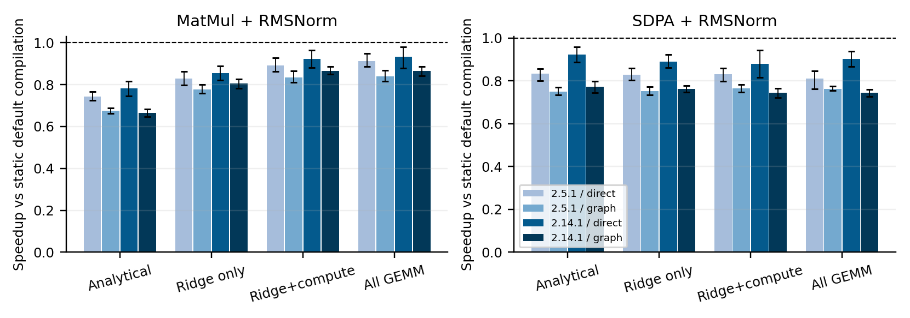
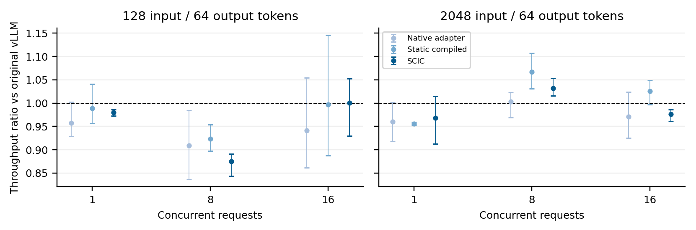
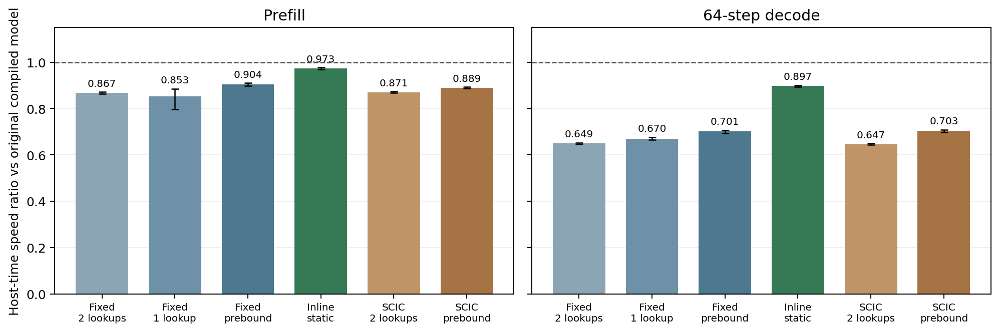

> 说明：本文是当前 `paper/jsa/main.tex` 的同步中文阅读稿，供审阅使用。正式投稿语言为英文；公式、实验口径与结果以同目录英文原稿为准。

# 面向 DNN 编译器双计划融合的形状条件算术强度分类

**Shape-Conditioned Intensity Classification for Dual-Plan Fusion in DNN Compilers**

作者：Longlong Liao、Xin Fang（通讯作者）、Weihong Zheng、Yuanlong Yu、Cen Chen。

单位：福州大学计算机与大数据学院；华南理工大学广州国际校区。

作者邮箱：`t20104@fzu.edu.cn`、`202510194375@mail.scut.edu.cn`、`241027248@fzu.edu.cn`、`yu.yuanlong@fzu.edu.cn`、`chencen@scut.edu.cn`，依次对应上述作者。

基金资助：国家自然科学基金（U21A20471）；福建省自然科学基金（2025J01537）。

目标期刊：Journal of Systems Architecture。

## 摘要

算子融合决策依赖张量形状、精度及中间流量。本文提出形状条件强度分类器 SCIC 与 DNN 编译器双计划接口，将解析算术强度与数据手册 Roofline 脊线比较，在不同区间建议 MemMode、ComputeMode，或保留两者。原型将抽象计划绑定至现有执行路径，并将解析建议与时延校准分开。

由正确性校验把关的评估覆盖 21 个 GEMM、9 个注意力形状、优化后的 PyTorch/编译器/库基线、近期融合工件，以及独立计时的实际函数分发。对先导框架的核查发现 FP16 归一化溢出，因而改用显式 FP32 统计。本文将选择器接入六层、8390 万参数、固定随机权重的完整 Qwen3 架构，保留残差和 FP16 舍入语义。两张 A40 上六个设备/进程重复中，相对原始编译模型的主机时间速度比为 prefill 0.870×、64 步 decode 0.670×。单张 A40 的实际 vLLM 0.31.0 生成实验中，SCIC 输出吞吐速度比为 0.971×，进程 bootstrap 95% 区间 [0.961, 0.978]；所有候选请求的生成 token 哈希与原始引擎一致。

这些退化表明，相对 eager 的子图收益不能证明系统加速。后续消融定位了接入成本；留出轮次的投影排序表明局部候选存在选择余量，但完整模型实测仍慢于原始模型。本文贡献是解析规划接口及可审计的执行证据；自定义强度引导内核的收益仍待验证，实际 DRAM 强度与预训练任务准确率未测量。

## 关键词

DNN 编译器；算子融合；Roofline 模型；算术强度；GPU 体系结构；PyTorch。

## 1 引言

算子融合能够减少深度神经网络执行过程中的内核启动和中间结果访存，但性能也取决于融合计算本身所需的资源。后处理阶段（epilogue）可能降低数据移动量，同时改变生产者的调度空间。因此，是否融合一对生产者与消费者，不能仅由算子的类型和邻接关系决定，还需要考虑张量形状、数据类型以及中间结果的处理方式。

解码（decode）与预填充（prefill）的区别说明了这种依赖。对于宽度为 4096 的 FP16 投影，冷片外流量模型给出的强度从单行解码时约 1 FLOP/byte，增加到 2048 行预填充时的 1024 FLOP/byte。注意力还引入了算法层面的差异：IO 感知预填充计划的强度可以随序列长度增长，而物化分数矩阵的计划则趋于固定上限。因此，融合接口应能够表达具体形状的资源区间，并在预测的资源转变附近保留备选计划。

本文提出 SCIC 与双计划规则。SCIC 计算解析算术强度，并将其与硬件对应的数据手册 Roofline 脊线比较。双计划规则生成访存导向的 MemMode、计算导向的 ComputeMode，或在可配置脊线区间内同时生成两种计划。这些模式描述预期的调度选择，包括后处理阶段的放置和分块偏好。它们是抽象计划模板；当前原型尚未证明其作为实际生成内核的效果。

原型将解析建议与可执行路径选择分开。对于 MatMul+RMSNorm，MemMode 初始绑定至 `torch.compile` 链，ComputeMode 初始绑定至 eager 链。时延探针可在配置范围内覆盖初始绑定：先导实验探测全部 GEMM，补充实验默认探测脊线及计算区间。对于注意力，两条候选路径都将注意力计算交给 PyTorch SDPA，可执行策略则在所有资源区间内编译 SDPA 与 RMSNorm 的完整链。因此，GEMM 实验评估校准后的路径选择，注意力实验评估固定的库后处理策略；二者均未实现抽象模式所描述的自定义分块调度。

数值等价性同样是解释路径时延的前提。对原始 FP16 MatMul+RMSNorm 核查发现，七个形状中有六个的 eager 平方操作溢出，而编译路径没有出现同样的输出坍缩。本文将归一化改为显式 FP32 中间计算，验证完整输出并执行三轮新的 A40 进程。修正后的先导运行保留用于追溯，主体评估另增加强基线、真实调度计时和完整模型接入。

先导主运行中，GEMM 校准选择相对 eager 的几何平均加速为 $1.296\times$，解析主计划为 $1.018\times$。三轮探针在 21 个常规计时选择中匹配 20 个。全部探针选择均编译链，always-fuse 获得相同的所选加速，因此本实验未证明校准优于固定编译。注意力编译链与 eager SDPA 的排序依赖形状和运行。先导实验评估记录路径排序；补充实验对优化后的静态基线独立计时真实选择，并验证完整小模型接入，如实报告观测到的退化。两者均不提供基于计数器的分类准确率或自定义分块调度证据。

后续接入消融通过不启动 profiler 的计时和留出排序检查，区分了调用开销与严格投影候选的互补性。

本文的贡献包括：

1. 给出 GEMM、注意力预填充与解码、归一化、归约及不规则分组 GEMM 的形状条件强度解析表达，并采用 H100 FP16、H100 FP8、A100 FP16 和 A40 FP16 数据手册锚点。
2. 提出将资源分类、抽象计划生成和可执行绑定分开的双计划接口，并实现对 MatMul+RMSNorm 路径进行校准的 PyTorch 原型。
3. 在两张 A40 上完成由数值校验把关的强编译器/库基线、独立实测分发、近期融合工件、完整随机权重小模型评估与受控接入诊断，报告选择开销、局部候选余量及观测到的系统退化。

第 2 节介绍资源模型与规划问题，第 3 节给出强度公式及解析规则，第 4 节说明可执行绑定和测量方法，第 5 节报告结果，第 6、7 节分别讨论相关工作与研究局限。

## 2 背景与问题定义

### 2.1 Roofline 模型与硬件锚点

Roofline 模型将算术强度与计算吞吐、内存带宽之间的平衡关系联系起来。算术强度 $\mathrm{AI}$ 与机器脊线 $R$ 定义为：

$$\mathrm{AI} = \frac{\mathrm{FLOPs}}{\mathrm{bytes}}, \qquad R = \frac{\mathrm{peak\ FLOP/s}}{\mathrm{peak\ byte/s}}.$$

对于峰值计算吞吐 $P$ 和峰值带宽 $B$，经典模型将执行时间估计为 $\max(\mathrm{FLOPs}/P,\ \mathrm{bytes}/B)$。低于 $R$ 的强度位于模型的带宽受限侧，高于 $R$ 则位于计算受限侧。该资源分类省略了启动开销、缓存效应和调度约束。因此，本文将强度作为规划特征，而不是任意编译子图的时延预测器。

表 1 列出 SCIC 使用的数据手册锚点。计算峰值为未采用结构性稀疏的稠密 Tensor-Core 数值。可执行评估使用 A40 FP16 锚点，其余锚点仅用于解析比较。这些峰值和脊线均不是在评估设备上实验测得的值。

**表 1. SCIC 的数据手册锚点。** $R$ 为峰值 FLOP/s 除以峰值 byte/s。对于 $N{=}K{=}4096$ 的方形投影，$M(0.5R)$、$M^{\star}$、$M(2R)$ 分别表示解析强度等于 $0.5R$、$R$、$2R$ 时的行数。FP8 行采用单字节元素与 FP8 峰值。仅 A40 FP16 用于硬件测量。

| 锚点 | 峰值 (TFLOP/s) | 内存带宽 | $R$ (FLOP/byte) | $M(0.5R)$ | $M^{\star}$ | $M(2R)$ |
| --- | ---: | --- | ---: | ---: | ---: | ---: |
| H100 SXM FP16 | 989 | 3.35 TB/s | 295.22 | 159.1 | 344.9 | 829.6 |
| H100 SXM FP8 | 1979 | 3.35 TB/s | 590.75 | 159.2 | 345.2 | 830.2 |
| A100 80GB FP16 | 312 | 2.039 TB/s | 153.02 | 79.5 | 165.4 | 359.8 |
| A40 FP16 | 149.7 | 696 GB/s | 215.09 | 113.5 | 240.3 | 544.6 |

### 2.2 融合规划与流量假设

本文考虑生产者后接后处理阶段的计算，例如矩阵乘后接 RMSNorm。规划问题是：在具体形状的资源需求下，决定生产者与后处理阶段如何共享执行区域。MemMode 表示将后处理并入生产者、避免中间结果片外往返并偏好较小分块的调度；ComputeMode 表示将较重的后处理留在矩阵乘主循环之外并偏好较大分块的调度。对于类 GEMM 生产者，ComputeMode 可以物化乘积。对于注意力，两种模式均在 IO 感知计划内保留分数计算，差别在于分块偏好及额外后处理阶段的放置。

这些描述定义计划的术语，并不意味着某个编译器或库调用已经实现所要求的分块调度。原型生成计划对象，而不生成自定义内核；其可执行绑定在第 4 节单独说明。

解析流量模型假定输入来自冷片外内存，并显式计入物化中间结果的写出与重读。模型不计 L2 复用、因果掩码与分页 KV 缓存，一次乘加计为两次 FLOP。所得字节数描述理想化流量，而不是指令轨迹或预热后基准的实际流量。本文统一使用“片外内存”，以覆盖 A40 评估设备，而不将所有设备的显存统称为 HBM。

## 3 形状条件分类与计划选择

解析方法首先估计计算位置的 FLOPs 和字节数，再按所选硬件脊线确定资源区间，最后构造一种或两种抽象计划。可执行绑定与时延校准是独立步骤，在第 4 节说明。这样，实测路径选择的变化不会被误认为新的算术强度测量。

### 3.1 GEMM 强度与后处理流量

对于形状分别为 $[M,K]$、$[K,N]$ 和 $[M,N]$ 的 $C{=}AB$，令 $e_A$、$e_B$、$e_C$ 为以字节计的元素大小。输入各读取一次、输出写出一次时：

$$\mathrm{FLOPs} = 2MNK, \qquad \mathrm{bytes} = MK e_A + KN e_B + MN e_C.$$

对于统一元素大小为 $e$ 的方形投影 $N{=}K{=}d$（FP16 下 $e{=}2$），强度化为：

$$\mathrm{AI}(M) = \frac{2Md}{(d + 2M)\,e}.$$

令 $\mathrm{AI}(M){=}t$，解得行数：

$$M = \frac{t\, e\, d}{2(d - t\, e)} \quad (d > t\, e).$$

当 $t{=}R$ 时，得到表 1 的平衡行数 $M^{\star}$。对于 A40 FP16 锚点，$M^{\star}{=}240.3$；强度等于 $0.5R$ 和 $2R$ 时，行数分别为 $113.5$ 和 $544.6$。图 1 给出相应的数据手册 Roofline 与解析强度曲线。七个 MatMul+RMSNorm 形状的生产者强度，从 $M{=}1$ 时的 $1.00$ 到 $M{=}4096$ 时的 $1365$，经过 $M{=}128$ 时的 $120$、$M{=}512$ 时的 $410$ 和 $M{=}2048$ 时的 $1024$。因此，同一投影在解码与预填充阶段可以具有不同的解析资源标签。

**图 1. 解析强度与 A40 数据手册 Roofline。** (a) 根据 $149.7$ TFLOP/s 和 $696$ GB/s 构建的模型上界，以及第 3.4 节使用的策略区间。标记取自修正后主运行决策日志的 `analytical_ai`，按构造放置在上界上，不代表实测吞吐。(b) $N{=}K{=}4096$、FP16 下的强度闭式。颜色表示修正后主运行的校准路径，七个形状均选择编译。$M^{\star}{=}240$ 是数据手册平衡点。

上述生产者强度也是 MatMul+RMSNorm 分类使用的特征，并非完整链的强度。为单独考察后处理融合可能带来的流量收益，未融合链读取 $A$、$B$，写出并重读 $C$，读取归一化权重，再写出归一化结果。理想融合调度消除 $C$ 的写出—重读往返，而 FLOP 数相对 GEMM 仅有较小变化。对于方形 FP16 投影，在忽略归一化权重项时，所节省的字节比例约为 $2M/(d+4M)$：从 $M{=}1$ 的 $0.05\%$、$M{=}32$ 的 $1.5\%$，增加到 $M{=}256$ 的 $10\%$、$M{=}2048$ 的 $33\%$ 和 $M{=}4096$ 的 $40\%$。

删除这些字节不意味着 Roofline 时间同比减少。采用 A40 锚点且不计启动项，未融合与融合模型时间的比值在 $M{=}128$ 为 $1.06\times$；在所有测试的 $M \ge 512$ 形状上为 $1.00\times$，因为两种记账均已计算受限。附录 C.3 将这一理想化预测与现有 PyTorch 路径比较，但不假设编译链实现了理想融合调度。

### 3.2 注意力预填充与解码

令 $Q,K,V$ 的形状为 $[B,H,S,D]$。对于 IO 感知预填充计划，主要 FLOPs 来自两个矩阵乘。假定分数保留在片上，且 $Q,K,V$ 和输出各移动一次，则强度为：

$$\mathrm{AI} = S / e.$$

在这些假设下，头维抵消，FP16 给出 $\mathrm{AI}{=}S/2$。测试序列长度 128、512、2048 对应解析强度 64、256、1024，分别落在 A40 的访存区、脊线区和计算区。这些是对假定 IO 感知计划的标签，而不是 SDPA 流量测量。

物化分数会改变渐近行为。对分数张量计三次内存遍历时，强度随 $S$ 增长的上限为 $4D/(3e)$。当 $D{=}128$、使用 FP16 时，上限为 $85.3$ FLOP/byte，低于 H100 FP16 锚点的 $0.5R$（$R{=}295$）。在此记账下，分数物化使预填充计划无法进入该锚点的计算区。Eager 注意力基线显式物化分数，SDPA 路径则将注意力交给库。因此，两类路径的比较同时涉及注意力实现和后处理放置。实验未记录库后端及其实际流量，不能独立验证解析模型的分数保留假设。

解码则将查询长度固定为 $S_q{=}1$ 并增长 KV 缓存。查询头数和 KV 头数分别为 $H_q$、$H_{kv}$ 时，长缓存极限为：

$$\mathrm{AI} \to \frac{2 H_q}{H_{kv}\, e}.$$

FP16 多头注意力趋于 $1$ FLOP/byte；分组查询注意力（GQA）在 $H_q/H_{kv}{=}8$ 时趋于 $8$ FLOP/byte，仍低于表 1 各锚点的 $0.5R$。两个测试解码形状使用 $H{=}8$、$D{=}64$，日志强度为 $0.992$、$1.000$。它们随缓存长度增加仍保持解析访存受限。因此，不能将计算导向预填充的标签直接用于这些解码负载。

解析注意力计划从不设置 `materialize_intermediate`。注意力 ComputeMode 表示较大分块和位于主循环之外的额外后处理，同时保留 IO 感知注意力约束。

### 3.3 归一化、归约与不规则分组 GEMM

原型建模的 RMSNorm、LayerNorm、softmax、残差加及其他逐元素链在 FP16 下具有 $O(1)$ FLOP/byte，因此直接采用 MemMode，不设置独立计算导向模板。例如，对物化分数矩阵上的 softmax，模型按每个分数五次 FLOP、三次内存遍历计数，强度为 $5/(3e)$，与 $S$ 无关。附录 A 汇总这些操作计数约定。

不规则分组 GEMM 说明了层级聚合量可能不足以指导规划。具有 $t_e$ 个 token 的专家计算 $[t_e,H] \times [H,I]$。表 2 在 $H{=}4096$、$I{=}14336$ 和 FP16 条件下，相对 H100 FP16 脊线评估该计算。聚合强度是已占用专家的总 FLOPs 除以总字节数，除最后一行外不计未激活专家权重。在偏斜场景中，8-token 专家访存受限，1024-token 专家计算受限，而聚合量仍位于脊线区。该解析示例说明应考虑逐专家计划，而不能仅从聚合量导出统一模板。可执行评估未计时混合专家层（MoE）。

**表 2. 解析分组 GEMM 强度。** $H{=}4096$、$I{=}14336$、FP16，采用 H100 FP16 数据手册脊线。Agg. 是总 FLOPs / 总字节数；Min、Max 是已占用专家的强度，单位均为 FLOP/byte。最后一行额外计入七个冷权重矩阵，但不增加 FLOPs。

| 场景 | Tokens | Agg. | Min | Max | 资源区间 |
| --- | ---: | ---: | ---: | ---: | --- |
| Decode，$8{\times}2$ | 16 | 2.00 | 2.00 | 2.00 | 访存 |
| Balanced，$8{\times}256$ | 2048 | 237 | 237 | 237 | 脊线 |
| Skewed，$1024{\ldots}8$ | 2040 | 236 | 7.98 | 775 | 访存到计算 |
| Prefill，$8{\times}2048$ | 16384 | 1247 | 1247 | 1247 | 计算 |
| 单专家 | 2048 | 1247 | 1247 | 1247 | 计算 |
| 全部八个权重移动 | 2048 | 237 | 1247 | 1247 | 聚合量在脊线区 |

### 3.4 解析分类与双计划规则

SCIC 在脊线附近设置区间，以降低严格平衡点附近小幅建模误差的影响。默认阈值为 $0.5R$ 和 $2R$，它们是可配置策略参数，而不是由实测不确定性推导的置信界限。输出同时报告严格的带宽或计算资源判断。根据计算位置的报告，解析计划生成遵循四条规则：

1. 逐元素链、归约、softmax 和归一化只生成 MemMode。
2. 对其他位置，$\mathrm{AI} < 0.5R$ 时只生成 MemMode，$\mathrm{AI} > 2R$ 时只生成 ComputeMode。
3. 脊线区内生成两种模式。$\mathrm{AI} < R$ 时以 MemMode 为主，否则以 ComputeMode 为主，另一模式作为备选。
4. 注意力在任一模式下均保留 IO 感知约束，不请求物化分数。

输出是计划建议，不是可执行内核或观察到的瓶颈。特别地，解析规则在区间外不提供备选。原型对全部 GEMM 进行校准，在选择现有库和编译器路径时有意放宽这一限制。附录 C.6 评估限制校准范围的后果。

## 4 原型与实验设置

### 4.1 分类器与计划接口

原型基于 Python 包 `shapefuse` 0.3.1 的当前工作区版本，修正了基准框架的归一化实现。`classify_site` 返回 FLOPs、字节数、强度、强度/$R$、三类资源区间和严格 Roofline 资源判断。除非提供实测强度，否则来源保持为 `analytical`；本文 A40 运行均未提供实测强度。`select_plan` 实现第 3.4 节，返回解析主计划、可选备选计划及 `kernel_emitted=false`。下文定义执行路径，附录 B 汇总名称。

### 4.2 可执行绑定与缓存

当前执行器将 MemMode 初始绑定至默认编译链，将 ComputeMode 初始绑定至 native 链；两者对相同的 FP16 乘积执行 FP32 RMSNorm 统计与权重乘法，最后转回 FP16。注意力始终绑定至 compiled-SDPA+RMSNorm。编译链这一名称不证明矩阵乘与完整归约被融合为单内核。

校准范围区分 analytical-only、ridge-only、默认 ridge-plus-compute 与 all-GEMM，保留 0.5R/2R 解析规则。缓存以形状、stride、dtype、设备、实现及设备身份形成精确签名，并保留解析桶元数据；没有准备过的签名必须先校准。每次实测调用实际执行所选函数。受控 Graph replay 绑定静态输入存储，拒绝不同输入存储的调用。

### 4.3 完整模型接入

接入点是实际注意力输出投影—残差加法—RMSNorm，其他注意力、RoPE、MLP、KV cache 与输出头保留。显式 FP16 线性边界保持矩阵乘的舍入位置，编译后处理启用精度 cast 模拟。HF 与 vLLM 各按自身残差/归一化语义验证；不能用放宽容差掩盖差异。每个策略在计时及 Graph capture 前准备精确签名，并与未修改原始模型及固定策略适配器分开比较。

### 4.4 正确性与计时义务

候选必须通过完整输出、多随机种子及更大幅值 GEMM 检查后才能计时；PyTorch 模型还比较相同 token 历史的完整 logits。数值拒绝、不可运行和有效时延分别记录。GPU events 与一次末尾同步的主机批次分开测量，准备、校准及常规样本分开记录。

主体实验形状、版本、采样数及系统请求参数在第 5 节给出。旧框架的路径名称、复制中位数和拆分计时口径移至附录 C 的先导协议，避免与实际执行器混淆。本文不将 kernel 名称或启动次数当作 DRAM 字节或分类准确率。

<!-- SCIC_V2_METHOD_START -->
### 4.5 SCIC-v2：候选成本先验与执行前准备

原来的强度区间规则作为旧版对照保留。Roofline 给出资源约束下的性能上界，不能直接判定哪个融合实现更快。SCIC-v2 将分析量用作候选成本特征，不再因形状被划为内存受限而跳过校准。

候选池限定为五个具体配置：Triton 投影采用 `(BLOCK_M, BLOCK_N, BLOCK_K)=(16,64,64)`、四个 warp，split-K 为 1、4、8；另两个候选采用 cuBLAS 投影加 Triton 残差/RMSNorm，分别使用四和八个 warp。split-K 的 FP32 部分和通过第二个内核逐个累加，避免同时载入整个分割维度；临时缓冲区增加的流量明确计入模型，不能预先声称融合必然减少显存流量。HF 和 vLLM 分别保留“残差先舍入后归一化”与“FP32 残差和参与归一化”的语义。

每个候选分别拟合同步主机批计时的对数延迟，岭回归正则系数固定为 `1e-3`。基础特征包含形状、执行方式、权重复用与调度配置；分析特征包含完整计算链 FLOPs、候选临时流量、Roofline 时间及相对强度。标准化和拟合仅使用训练形状，留一训练几何的绝对对数残差第 95 百分位作为经验不确定性边界，不把它称为具有分布无关保证的置信区间。no-AI 消融仅去掉分析特征。

准备阶段先检查和探测训练集选出的固定候选及预测最优挑战者；若未探测候选的下界可能再改善至少 2%，则扩展候选池。所有候选先过数值门槛。只有预计调用次数产生的收益覆盖增量准备成本，才替换固定候选。编译、数值验证和探测分别记录，仅减少探测不能证明总准备成本降低。

`prepare` 在外层编译或 CUDA Graph 捕获前返回固定端点，缓存包含布局、精度、设备、软件和实现版本、归一化语义、epsilon、权重身份和版本。HF 通过 `triton_op` 和 `wrap_triton` 让外层编译器看见具体计算，稳态路径没有逐层精确键分派或嵌套编译函数。vLLM 在实际权重加载完成、线程设置完成后，在编译和捕获前准备；新算子明确声明并直接更新残差，不引入旧适配器为探测安全而添加的残差克隆。新版保持显式启用，支持范围限定为 FP16、TP=1 和已检查的 Qwen3 接口。
推理张量不提供自动变更计数；调用方修改冻结的投影或归一化权重时，必须显式递增 weight-version 并重新准备。当前模型接入假定加载后的权重不变，不能据此声称支持任意在线权重变更。

服务准备若没有同时满足声明 decode/prefill 负载的合格候选，会在追踪前恢复该层原生 vLLM 投影和 forward，并记录原生部署及拒绝原因；稳态执行不增加回退分支。

<!-- SCIC_V2_METHOD_END -->

## 5 评估

主体评估测量实际执行的选择器，比较优化后的静态基线，并验证完整小型模型。旧先导实验的 SCIC 时延复制了基线路径的中位数，相关数据保留在附录 C；其相对 eager 的比值不作为系统级加速证据。

<!-- SUPPLEMENT_EVALUATION_START -->

### 5.1 问题、工作负载与基线层次

补充实验回答三个问题：真实选择器能否优于优化后的静态路径，近期融合工件能否在同功能上比较，以及子图结果能否转化为完整推理收益。eager 作为数值和常规执行参考，不代表最新优化水平。强基线包括默认编译、关闭内部 CUDA Graph 的 max-autotune、库 SDPA 与 FlashAttention-2；直接调用与统一完整链 Graph replay 分组报告。

GEMM 矩阵包含 21 个形状：保留宽度 4096 的 7 个先导形状，增加宽度 1024/8192、M=1/128/512/2048 的 8 个方形投影，以及 (K,N)=(1024,3072)/(3072,1024)、M=1/128/512 的 6 个矩形投影。注意力包含 9 个形状：保留原有 5 个，并增加 D=128、S=512/2048 的 causal prefill，以及 batch=8、Hq=16、Hkv=8、D=64、Sk=128/2048 的 GQA decode。单查询 decode 可见全部已提供 KV；左上角三角掩码会错误屏蔽缓存 token。

PyTorch 2.5.1+cu121 与独立配置的 2.14.1+cu126 分开记录。每条候选通过完整输出检查后才计时，并测试第二个随机种子和更大幅值 GEMM 输入。GEMM 对 FP16 乘积及 FP32 归一化参考采用相对/绝对容差 1e-3；注意力对 FP32 参考采用 1e-2。拒绝或不可运行的候选无性能值；与 max-autotune 的比较仅使用共同通过的样本。

### 5.2 实际执行、计时与校准成本

补充执行器每次调用真实所选函数，SCIC 时延不再来自其他行。缓存在解析桶之外加入实际形状、stride、dtype、device、实现与设备身份；未准备的签名必须在计时或 Graph capture 前准备，避免桶内错误复用。

解析规则与 0.5R/2R 阈值保持不变。主策略仍为 ridge-compute，另外分别测 analytical-only、ridge-only 与 all-gemm；ridge-only 是新增实验变体，并未替换原默认值。注意力保留固定编译 SDPA 绑定，因此其结果不证明自适应注意力选择。校准与正式计时使用独立样本，校准设置成本单独记录。

算子预热 50 次、计时 200 次，同时记录 CUDA event 区间和同步主机批次。event 区间可能包含主机调度形成的空隙，不能解释为纯内核运行时间。主机批次包含真实调度和启动，一次最终同步分摊至调用。编译准备和数值验证在正式计时之外。每个进程保留命令、逐次样本、校验与可获得的 kernel/backend 信息。两张 A40 分别运行独立进程，每张重复三次，失败与中断记录保留。

### 5.3 近期融合工件与复现边界

对 RedFuser、Neptune 的公开 2026 工件进行适配，注意力主体后接同一编译后的 FP32 RMSNorm，完整链直接计时。该对比评估可执行函数，不能解释为分类器准确率，也不是作者原文加速比的复现。官方默认 schedule 明确标注，不等同于穷尽 autotuning。

RedFuser 固定提交 56bf0b28，Neptune 固定提交 f7975011。RedFuser 生成器需要处理 SymPy 恒等常量和单位维度 TIR 索引，兼容补丁单独归档；初始完整输出审计仍拒绝重新生成的内核。官方提交中的预生成内核单独测试，仅改变形状常量和启动范围。该工件成功运行不等于自动生成器复现成功。未支持的 causal、GQA 和 head-dimension 配置不以其他实现代替。Neptune 使用其官方 PyTorch 2.6/Triton 3.2 组合及启用 LLVM 的构建。构建失败、兼容失败、数值拒绝与实测结果分别记录。

现有硬件为 Ampere A40。FA3/FA4 及依赖 Hopper/Blackwell 特性的 ComFuse 实现只作为相关工作，不声明为 A40 复现。不同编译器环境分别重跑匹配基线，不混合解释。

### 5.4 完整小模型推理

完整执行图验证无需大型 checkpoint。本文使用六层 Qwen3 架构：hidden=1024、FFN=3072、16 个查询头、8 个 KV 头、head_dim=64、词表 8192、绑定输入输出嵌入，共 83,900,160 个参数。模型固定随机初始化，无预训练权重下载，测量范围为架构和运行时性能，不包括语言任务准确率。

适配器接入实际“输出投影→残差相加→RMSNorm”区域，保留注意力、RoPE、MLP、残差、KV cache 和输出头。显式 linear 边界保留 FP16 GEMM 舍入，编译后处理模拟模型的精度转换；缺少该边界时，addmm 改写会改变残差舍入位置，无法通过组件数值门槛。所有有效变体在相同 teacher-forced token 历史上通过完整 logits 对比。

PyTorch 工作负载采用 batch=1/8、prompt=128/2048、64 步 decode，所有变体使用相同的外层默认编译配置并关闭内部 CUDA Graph。分别测量原生编译模型、固定原生路径适配器、固定编译路径适配器和默认 SCIC。固定原生适配器揭示接入开销，固定编译适配器检验选择是否优于静态策略；模型计时包含真实适配与调度成本。

六次设备/进程重复、四个工作负载上，SCIC 相对原生编译模型的主机时间几何平均速度比为 prefill 0.870×、64 步 decode 0.670×，两者均为退化。固定编译适配器分别为 0.869×、0.675×。结果说明，先导子图比值不能解释为完整模型加速；当前不透明接入边界和重复运行时调度限制了实现，校准未抵消这些成本。

**图：完整小模型推理。** 见 `figures/fig_supplement_system.pdf`。速度比相对原生编译模型，低于 1 表示退化；误差条为进程级 bootstrap 区间。工作负载包含 KV cache 和输出头，采用 teacher-forced token，不测任务准确率。

<!-- SUPPLEMENT_RESULTS_START -->

### 5.5 优化基线与近期研究的实测比较

下表报告独立计时的默认 ridge-plus-compute SCIC；数值小于 1 表示退化。注意力 native 是 SDPA+RMSNorm，不是物化注意力。与 max-autotune 的比值只使用共同通过数值验证的配对样本，括号注明样本量。相对 eager 的收益不能证明优于默认编译。

| PyTorch | 负载 | 计时 | 配对数 | / native | / default | / max-no-graph（配对数） |
| --- | --- | --- | ---: | ---: | ---: | ---: |
| 2.5.1 | GEMM | Direct | 126 | 1.225 | 0.890 | 0.839 (116) |
| 2.5.1 | Attention | Direct | 54 | 1.045 | 0.830 | 0.831 (54) |
| 2.5.1 | GEMM | Graph | 126 | 1.203 | 0.835 | 0.804 (116) |
| 2.5.1 | Attention | Graph | 54 | 1.031 | 0.765 | 0.762 (54) |
| 2.14.1 | GEMM | Direct | 126 | 1.161 | 0.922 | 0.834 (114) |
| 2.14.1 | Attention | Direct | 54 | 0.982 | 0.880 | 0.900 (54) |
| 2.14.1 | GEMM | Graph | 126 | 1.359 | 0.866 | 0.897 (114) |
| 2.14.1 | Attention | Graph | 54 | 1.090 | 0.745 | 0.745 (54) |

图：解析、ridge-only、默认 ridge-plus-compute 和 all-GEMM 范围的独立实测速度比及进程 bootstrap 区间。0.5R/2R 规则保持不变；注意力始终采用固定 compiled-SDPA 绑定。

默认范围 GEMM 校准的耗时包含候选准备之后的探测调用和同步；不包含编译准备与数值审计。
PyTorch 2.5.1 / none：84 次探测，中位数 9.264 ms，p95 146.433 ms。
PyTorch 2.5.1 / manual：84 次探测，中位数 7.360 ms，p95 145.861 ms。
PyTorch 2.14.1 / none：84 次探测，中位数 10.272 ms，p95 146.695 ms。
PyTorch 2.14.1 / manual：84 次探测，中位数 6.953 ms，p95 145.534 ms。

近期研究各使用一张 A40 上 3 个进程重复，与各自环境的编译基线比较，不进行跨环境排名。RedFuser 表示独立参数化的仓库预生成内核，不表示自动再生成成功。采用官方默认 schedule；不支持的形状没有性能值。

| 工件 | 计时 | 形状数 | 配对数 | / default | / max-no-graph（配对数） |
| --- | --- | ---: | ---: | ---: | ---: |
| RedFuser committed | Direct | 5 | 15 | 1.237 | 1.340 (15) |
| RedFuser committed | Graph | 5 | 15 | 1.028 | 0.936 (15) |
| Neptune TVM | Direct | 7 | 21 | 0.700 | 0.727 (21) |
| Neptune TVM | Graph | — | 0 | 当前桥接不支持 | 当前桥接不支持 |
| Neptune Torch | Direct | 5 | 15 | 0.495 | 0.501 (15) |
| Neptune Torch | Graph | 5 | 15 | 0.958 | 0.983 (15) |

Neptune 的 TVM/Triton 桥接在完整链 CUDA Graph capture 中发生 SIGSEGV，相关进程失败保留在归档中；后续捕获明确拒绝，避免重复崩溃。此结果是当前适配器的兼容性边界，不影响通过校验的直接调用。

逐形状时延、进程 bootstrap 区间、候选接纳状态、可获得的后端轨迹及校准耗时保存在补充分析目录。测得的候选最小值仅涵盖通过验证的执行路径，不代表全局最优 schedule。

Neptune 官方导出的 Torch 可调用 Triton 接口要求启动配置使用 Python 整数；归档补丁将 TVM 整数转换为相同数值的 Python 整数，不改变参数值或 schedule。最初失败序列另行保留；Torch 桥接的接纳样本不包括多内核 decode 组合和 GQA。

**框架自管 Graph。** 本组使用自身的直接默认编译基线，对普通、未标记静态地址的张量参数测量 reduce-overhead 与 max-autotune 内部 Graph；profiler 轨迹包含输入复制内核。受控手动 replay 捕获固定存储，模型参数则由框架另行处理，各协议分开报告。

| 负载 | 模式 | 配对数 | / default |
| --- | --- | ---: | ---: |
| attention | max-autotune | 27 | 0.871 |
| attention | reduce-overhead | 27 | 0.906 |
| gemm | max-autotune | 57 | 0.655 |
| gemm | reduce-overhead | 63 | 0.659 |

**FlashAttention-2。** 在 PyTorch 2.5.1 的 GPU-1 环境测量 FA2 与同一 FP32 编译归一化后处理。接纳覆盖明确列出；CUDA 扩展依赖 PyTorch ABI，没有跨用到独立的 2.14.1 环境。

| 计时 | 形状数 | 配对数 | / compiled-SDPA |
| --- | ---: | ---: | ---: |
| Graph | 9 | 27 | 1.016 |
| Direct | 9 | 18 | 0.651 |

<!-- SUPPLEMENT_RESULTS_END -->

<!-- VLLM_RESULTS_START -->

### 5.6 实际 vLLM 服务引擎接入

进一步将适配器接入 vLLM 0.31.0 的 V1 AsyncLLM 引擎。环境采用 CUDA 12.9 vLLM 轮包与 PyTorch 2.13.0+cu126，沿用现有驱动；官方匹配的 torchvision/torchaudio CUDA 12.6 轮包与 CPU torchcodec 消除了无关多媒体依赖的 CUDA 13 导入要求，依赖检查和实际引擎启动均通过。

服务实验使用 1 张 A40，每种策略 3 个独立进程重复。0 号卡持续占用使该卡服务序列未通过空闲启动门槛；两卡算子和 PyTorch 完整模型实验单独报告。

采用同一完整小型 Qwen3 架构、固定种子 dummy 权重、FP16、TP=1 和 token-ID 输入，不下载预训练权重。每种策略独立工作进程；统一保留 prefix caching、chunked prefill、框架默认编译/Graph，最大上下文 4096、最大序列 16、批处理 token 上限 4096。输入长 128/2048，并发 1/8/16，每请求生成 64 token；先预热两批，再测量 128 请求。确定且唯一的随机前缀避免跨请求 prefix reuse。

比较原始引擎、固定 native、固定 compile 与 SCIC 适配器。候选通过接入点数值检查后，每个接纳请求的完整生成 token 哈希还与同种子、负载、请求 ID 的原始引擎完全一致。此检查针对生成 token；未单独导出 vLLM 完整词表 logits。PyTorch 模型实验另行检查完整 logits。

六种负载与 3 个配对进程重复中，SCIC 相对原始引擎的输出吞吐几何平均速度比为 0.971×，进程 bootstrap 95% 区间 [0.961, 0.978]，在本配置下为总体退化，单个负载结果有差异。固定 compile 适配器为 0.992×。

| 输入长 | 并发 | 原始 tok/s | SCIC tok/s | 速度比 [95% CI] | 原始 TTFT p95 (ms) | SCIC TTFT p95 (ms) |
| ---: | ---: | ---: | ---: | ---: | ---: | ---: |
| 128 | 1 | 538.9 | 531.4 | 0.980 [0.972, 0.986] | 12.45 | 13.78 |
| 128 | 8 | 3573.6 | 3185.9 | 0.875 [0.843, 0.892] | 23.58 | 54.74 |
| 128 | 16 | 5686.6 | 5382.3 | 1.001 [0.930, 1.053] | 38.62 | 60.55 |
| 2048 | 1 | 513.8 | 503.4 | 0.968 [0.912, 1.015] | 14.05 | 15.79 |
| 2048 | 8 | 2046.5 | 2148.9 | 1.032 [1.016, 1.053] | 96.49 | 103.95 |
| 2048 | 16 | 2953.3 | 2841.1 | 0.977 [0.961, 0.986] | 137.91 | 154.92 |

客户端测量包含 IPC、调度、KV cache、采样和流式返回；总吞吐也包含确定性 prompt 构造，而单请求 TTFT 从构造之后计时。排除 tokenizer 与 HTTP 传输。ITL 使用客户端观察到的到达时间，合并返回的 token 共享时间戳。常规计时外的准备与请求中出现的新签名工作保留其实际计时位置。可获得的最终 SCIC worker 记录 84 个层/签名准备项、469.467 ms 校准；早期统计 RPC 失败另行保留，不以推断值替代。

图：token 校验后的实际 vLLM 吞吐相对原始优化引擎的速度比；误差线按独立进程重复 bootstrap。随机权重和固定批次到达不验证预训练质量或生产请求分布。

<!-- VLLM_RESULTS_END -->

<!-- SUPPLEMENT_EVALUATION_END -->

<!-- ADAPTER_ABLATION_START -->

### 5.7 接入开销的后续诊断

针对完整模型退化，进一步进行受控消融，而不预设调整分类阈值就能恢复优势。使用 PyTorch 2.5.1、Transformers 4.51.3，在两张 A40 上重复四个 HF 负载，每个设备/负载 3 个独立进程。两卡实验流在同一主机上并行运行；策略在同一进程、负载内配对。95% 区间对固定负载矩阵中的 6 个设备/轮次簇进行 bootstrap。

最初试验在同一进程中交替运行 profiler 和后续策略计时。单独的受控检查对同一个已预热原始模型 decode 函数，在一次 CUDA profiler 会话前后各测量 3 个批次；即使 profiler 上下文已经退出，GPU 0、GPU 1 的后/前主机时间速度比仍分别为 0.853×、0.834×。这些进程内批次只作为描述性检查，不计为独立重复。最初试验保留，但从全部最终时延和候选汇总中排除；seed 0 在完全不初始化 profiler 的进程中重新测量。因此，初始试验的内联表面优势不作为加速证据。

七个变体统一采用静态外层编译，关闭内部 CUDA Graph，并启用精度 cast 模拟；decode 位置张量在计时前分配。该共同配置与先前模型实验不同，速度比不合并。每个变体的 eager、compiled 输出都通过 prefill 和全部 64 步 teacher-forced decode 的完整 logits 检查，保持相对/绝对容差 1e-2。Prefill 预热 5 次、测量 20 次，decode 循环预热 2 次、测量 20 次；分别保留 CUDA-event 样本及单独同步的主机批次。准备、校准和 profiler 样本不进入常规时延。

归档适配器每次调用构造两次精确签名；单次查找直接调用已缓存的执行入口。预绑定为每层的固定 prefill/decode 阶段冻结经过验证的函数，调用方检查阶段形状，外层编译器提供静态 guards。SCIC 预绑定复用同进程旧路径在外层编译前的选择，避免重新选择造成干扰。这是固定负载特化，尚未实现通用动态形状运行时。静态内联路径移除外层投影—残差—归一化自定义算子及嵌套编译函数，同时保留不透明 FP16 线性边界和 affine 前的 cast 语义；该路径不包含自适应选择，也没有新 MemMode/ComputeMode 调度。单次查找实现已接入通用适配器，同时保留显式的两次查找诊断对照。

| 执行路径 | Prefill / 原始 | Decode / 原始 | Prefill / 固定 | Decode / 固定 |
| --- | ---: | ---: | ---: | ---: |
| 固定编译，两次查找 | 0.867 | 0.649 | 1.000 | 1.000 |
| 固定编译，一次查找 | 0.853 | 0.670 | 0.984 | 1.032 |
| 固定编译，预绑定 | 0.904 | 0.701 | 1.043 | 1.079 |
| 严格内联，静态方案 | 0.973 | 0.897 | 1.122 | 1.382 |
| SCIC，两次查找 | 0.871 | 0.647 | 1.004 | 0.996 |
| SCIC，预绑定 | 0.889 | 0.703 | 1.026 | 1.083 |

相对两次查找的固定适配器，单次查找的 prefill/decode 速度比为 0.984×、1.032×；预绑定为 1.043×、1.079×。预绑定固定方案相对原始模型仍为 0.904×、0.701×；SCIC 预绑定为 0.889×、0.703×。仅移除签名查找不足以恢复完整模型损失。单次查找相对固定方案的 prefill 区间为 [0.914, 1.024]，包含 1，并保留一个异常缓慢的主机批次，因此不声称稳定 prefill 收益。

严格静态内联相对原始模型的 prefill 速度比为 0.973×（95% 区间 [0.969, 0.977]），decode 为 0.897×（[0.893, 0.901]）。该结果属于静态编译路径的接入优化，不能作为自适应选择优势。

图：共同后续协议下的接入消融。误差条对设备/轮次簇重采样；原始编译模型为单位参考。严格内联是静态方案，预绑定特化固定 prefill/decode 签名。

Profiler 轨迹来自单独归档的诊断进程；最终时延矩阵的进程不启动 profiler。96 个变体/负载/阶段配对的 CUDA 事件数均与对应原始模型一致；不透明适配器每次 prefill 进入 7 个 compiled region、执行 7 次 Dynamo 查找，原始与内联路径为 1 次，64 步 decode 分别为 448 次与 64 次。预绑定移除了精确签名调度，但保留嵌套编译调用。归档保留 CUDA 事件名称/次数与 CPU 操作次数；这些信息描述执行结构，不是 DRAM 流量，也不提供内核时间的独立因果分解。

另对实际六种行数 M∈{1,8,128,1024,2048,16384}、宽度 1024 的完整投影—残差—RMSNorm 进行诊断，共 6 个设备/轮次簇。采用与初始化模型一致的权重幅值及单位归一化权重，组件容差保持 1e-3。36 个形状/进程配对中，native 在 25 个主机批次、22 个 event 中位数上获胜；逐形状取 native/compiled 最小值，相对固定编译的乐观速度比为主机 1.155×、event 1.130×。该最小值使用常规样本，是当前候选集的诊断上限，不是实际选择器性能或全局调度最优值。最初使用任意归一化权重的 smoke 样本未通过未改变的组件门槛，拒绝记录保留，该签名不提供性能证据。

进一步留出每个 seed 的两张卡，仅根据另外两个 seed 的 event 中位数为已知形状选择候选。留出样本相对固定编译的速度比为主机 1.150×、event 1.127×；每个折中，训练数据选择的最佳固定候选均为 compiled。该离线策略在 M=1/8/128/1024 选择 native，在 M=2048/16384 选择 compiled。此检查只验证已知形状的排序稳定性，不包含分发和校准成本，也不是实际自适应执行或未见形状泛化。默认解析绑定在访存区间不探测而直接选 compiled，可能遗漏观测到的小行数 native 优势。交叉点涉及严格适配器的现有执行路径，尚未证明具体资源导向内核调度发生转变。

后续诊断区分了可以恢复的接入开销与尚未确立的解析选择价值。严格投影候选存在可测的局部选择余量，但接入开销使其不能直接解释为系统加速。下一轮实际执行应在相同调用路径下比较全形状实测校准、默认 SCIC 与最佳固定适配器。要证明强度引导调度优势，还需要具体备选调度，以及解析特征相对纯实测校准的增量价值。这轮诊断未将优化适配器接入 vLLM，也未验证预训练归一化权重。

<!-- ADAPTER_ABLATION_END -->

<!-- SCIC_V2_RESULTS_START -->

### 5.8 具体内核、留出选择与真实权重验证

新版结果单独存入 `paper/data/jsa_v2/`，不与旧环境数据合并。环境为 PyTorch 2.13.0+cu126、Triton 3.7.1、Transformers 5.17.0、vLLM 0.31.0，A40、FP16、TP=1、CPU 单线程。正式计时进程不初始化 profiler。32 个投影几何中，23 个用于训练，平方宽度 2048/8192 的九个几何用于留出测试；直接执行/CUDA Graph、单权重重复/六权重轮换分别统计。每候选预热 50 次，采集 200 个事件样本和五个 40 调用同步主机批；选择使用独立的三次预热、五个八调用主机批。

组件对三组随机输入、单位/非单位归一化权重和压力输入检查两个完整输出，要求 `atol=rtol=1e-3` 且相对 L2≤`1e-3`。保留候选拒绝及原生回退，不能用候选池的乐观最小值代替真实可用方法。

已完成正式进程：HF 算子 6、vLLM 语义算子 5、未改动旧 SCIC 5、随机 HF 模型 5、真实权重 HF 模型 3；未完成阶段没有实测结论。

| 语义 | 执行 | 权重 | 策略 | 相对完整校准的稳态比 | 总准备速度比 | AI/no-AI |
|---|---|---|---|---:|---:|---:|
| HF | direct | same | scic-v2 | 0.998 | 1.000 | 1.000 |
| HF | direct | same | scic-v2-no-ai | 0.998 | 1.000 | -- |
| HF | direct | rotated | scic-v2 | 0.998 | 1.000 | 1.000 |
| HF | direct | rotated | scic-v2-no-ai | 0.998 | 1.000 | -- |
| HF | graph | same | scic-v2 | 1.002 | 1.000 | 1.000 |
| HF | graph | same | scic-v2-no-ai | 1.002 | 1.000 | -- |
| HF | graph | rotated | scic-v2 | 0.999 | 1.000 | 1.000 |
| HF | graph | rotated | scic-v2-no-ai | 0.999 | 1.000 | -- |
| vLLM | direct | same | scic-v2 | 0.982 | 1.000 | 0.995 |
| vLLM | direct | same | scic-v2-no-ai | 0.987 | 1.000 | -- |
| vLLM | direct | rotated | scic-v2 | 0.988 | 1.000 | 1.000 |
| vLLM | direct | rotated | scic-v2-no-ai | 0.988 | 1.000 | -- |
| vLLM | graph | same | scic-v2 | 1.000 | 1.000 | 1.000 |
| vLLM | graph | same | scic-v2-no-ai | 1.000 | 1.000 | -- |
| vLLM | graph | rotated | scic-v2 | 0.999 | 1.000 | 1.000 |
| vLLM | graph | rotated | scic-v2-no-ai | 0.999 | 1.000 | -- |

16 个已测域中，0 个同时达到稳态性能不低于完整校准的 98%、总准备成本降低至少 30%。总成本包含编译、验证和探测，不能仅根据探测次数减少认定成功。分析特征的增量价值须相对 no-AI 独立判定。

真实权重为固定 revision `c1899de289a04d12100db370d81485cdf75e47ca` 的 Qwen/Qwen3-0.6B，所有对照均使用 FP16。其投影为 K=2048、N=1024，属于外部几何验证，不能加入主训练集。随机 HF 保留四个工作负载，真实模型使用 B=1/S=128 与 B=8/S=2048。完整 logits 的逐元素容差为 `1e-2`，额外严格相对 L2 门槛为 `1e-3`，检查 prefill 及全部 64 个 teacher-forced decode 输出。严格失败即使通过逐元素容差，也只能保留探索性计时，不能支持主加速结论。独立诊断中随机权重原模型从 eager 转为编译也可能超过严格相对误差门槛，这不是看过结果后调整门槛的理由。

实际 vLLM 使用每工作负载 128 个请求、每请求 64 个贪心生成 token，随机模型六个、真实模型四个工作负载，保留完整输出哈希、TTFT、ITL 和准备成本。动态 token 维度不能被 Python 形状条件专门化，因此部署时按 64 次 decode/一次 prefill 的声明负载比例固定每层一个候选；不能据此声称验证了任意形状的动态路由。哈希一致仅说明这些请求生成等价，不代表语言任务准确率。

| 策略 | 随机 HF prefill | 随机 HF decode | 真实 HF prefill | 真实 HF decode | 随机 vLLM | 真实 vLLM |
|---|---:|---:|---:|---:|---:|---:|
| best-fixed | 1.005 (10) | 0.999 (10) | 1.004 (3) | 1.000 (3) | -- (0) | -- (0) |
| legacy | 0.780 (10) | 0.590 (10) | -- (0) | -- (0) | -- (0) | -- (0) |
| full-calibration | -- (0) | -- (0) | -- (0) | -- (0) | -- (0) | -- (0) |
| scic-v2 | -- (0) | -- (0) | -- (0) | -- (0) | -- (0) | -- (0) |
| scic-v2-no-ai | -- (0) | -- (0) | -- (0) | -- (0) | -- (0) | -- (0) |

HF 算子采用两张 A40 上六个独立进程；另一张卡未通过空闲门槛后，其余随机模型域在物理 GPU 1 上重复五次，真实权重域重复三次。这衡量进程变化，并非五张独立设备。旧控制的注册失败运行保留并排除，修正后仅与相同 GPU/轮次/几何的优化基线配对。算子扫描已准备全部候选，表中准备成本属于包含共同编译/验证开销的扫描协议，不能直接推断冷启动的按需准备成本。模型工件另行记录实际准备成本，且保留编译缓存状态的限制。

HF 语义下，split-K=4 与 8 分别只有 3、3 个不同的数值合格训练几何。每候选单独拟合，恒定的候选身份特征不会提供额外形状信息；较大的留一几何残差经常迫使扩大探测。这反映训练覆盖与模型可识别性的限制，不能证明算术强度能决定最优调度；审计不使用留出时延调整特征或超参数。

hf/best-fixed 的 20 个实测工作负载中，10 个在所有层/阶段回退到原生函数端点，其中 10 个通过严格 logits；这些计时不能证明融合候选收益。

随机模型 HF 的实际组件准备速度比为 1.1676 [0.9660, 1.5901]，其中 0 个配对工作负载的两种策略均通过严格完整 logits。该描述性比值不能证明有效系统加速，也不能代表冷缓存启动。

hf-pretrained/best-fixed 的 6 个实测工作负载中，3 个在所有层/阶段回退到原生函数端点，其中 3 个通过严格 logits；这些计时不能证明融合候选收益。

真实权重 HF 的实际组件准备速度比为 1.1979 [1.0117, 1.5833]，其中 0 个配对工作负载的两种策略均通过严格完整 logits。该描述性比值不能证明有效系统加速，也不能代表冷缓存启动。

HF 语义下，按 direct/same、direct/rotated、graph/same、graph/rotated 排列的 v2/完整校准稳态比及 95% 进程区间为：0.9975 [0.9932, 1.0000]；0.9976 [0.9929, 1.0002]；1.0023 [0.9991, 1.0080]；0.9990 [0.9986, 0.9995]。

vLLM 语义下，按 direct/same、direct/rotated、graph/same、graph/rotated 排列的 v2/完整校准稳态比及 95% 进程区间为：0.9818 [0.9759, 0.9876]；0.9880 [0.9872, 0.9887]；0.9998 [0.9994, 1.0004]；0.9994 [0.9978, 1.0006]。

括号为严格数值或完整生成哈希通过的配对观测数。按 GPU/独立进程聚类进行 5000 次 bootstrap，先在进程内平均对数比值，不把单次计时当作独立重复。系统主加速结论还要求至少 1.02×、95% 区间下界大于一、完整数值/请求覆盖。理论冷流量不等于实测 DRAM 流量，真实权重推理也不等于任务准确率评估。

<!-- SCIC_V2_RESULTS_END -->

## 6 相关工作

**资源建模。** SCIC 使用 Williams 等人的经典 Roofline 形式构建逐位置规划特征。本文关注将形状相关流量引入计划接口，而不是提出新的 Roofline 模型。用数据手册代替实测吞吐和带宽，限制了标签的解释范围。

**IO 感知注意力。** FlashAttention 和 FlashAttention-2 围绕片上分数处理组织注意力，以减少流量；FlashAttention-3 进一步面向 Hopper 执行与低精度。这些系统实现注意力内核，而 SCIC 将 IO 感知与物化分数计划的区别作为解析输入。先导实验未识别 SDPA 后端；补充工件记录可获得的后端/内核轨迹，并单独测量 FlashAttention-2。名称与轨迹不能代替实际 DRAM 流量。

**融合与归约调度。** ComFuse 将矩阵乘与访存密集后处理子图结合，通过 Stage-Stream 模型将调度映射至 CUTLASS。RedFuser 使用 TVM 生成级联归约的融合形式，包括类注意力模式。Neptune 对归约依赖进行代数变换，以恢复注意力及相关 GPU 计算的局部性与并行性。这些方法构造可执行内核或调度；SCIC 生成解析计划建议并选择可执行路径；补充评估单独测试可运行的研究注意力工件，记录 RedFuser 再生成被数值验证拒绝的结果，不声称复现其已发表的总体加速。

**融合粒度。** FuseFlow 研究流式数据流硬件上稀疏模型的融合粒度，SCIC 关注具体稠密 GPU 形状的资源区间。两种场景均涉及不同执行区域间的选择，但本文负载与硬件不支持直接性能比较。

**编译器基础设施。** TorchDynamo 和 TorchInductor 提供原型使用的 `torch.compile` 路径，Triton 参与 GPU 代码生成。框架比较编译链与 eager 执行，并未修改编译器融合启发式。与解析绑定的不一致说明值得检验如何将资源特征和实测选择引入这些启发式；当前实验未评估此集成。

## 7 讨论与局限

### 7.1 解析标签的解释范围

数据手册脊线是参考值，`measured_ridge_flops_per_byte` 保持为空。早期 A40 包的设备拷贝估计标记为 `ESTIMATE_COPY_NOT_NSIGHT`，并不测量该脊线。冷字节模型省略缓存复用、掩码、分页 KV 及 eager FP32 转换临时张量；$0.5R$/$2R$ 区间，以及 softmax 和 RMSNorm 操作数，均是建模选择。没有阈值敏感性实验确立最优区间。校准范围重放改变的是采用哪些记录选择，而不是实测资源分类的准确率。

GEMM 结果揭示了资源导向调度与可执行代理之间的差异。MemMode/ComputeMode 尚未作为具体分块大小、寄存器分配或共享内存占用进行测试。all-GEMM 消融可以不受解析区间约束，选择任一现有路径。其结果评估的是候选排序与校准覆盖，尚未确立解析特征相对纯实测校准的增量收益。后续严格投影候选存在互补优势区间，但留出排序收益不包含运行时分发和准备成本（第 5.7 节）。分组 GEMM 示例与 H100/A100 锚点仅有解析结果。

### 7.2 测量范围

时延比较未采集 Nsight DRAM 字节。早期 `ncu` 尝试以 `ERR_NVGPUCTRPERM` 失败。独立现有矩阵乘归档中的 torch-profiler 内存估计等于 FP16 输出矩阵大小，使其隐含强度保持在 $K{=}4096$，将所有形状判为计算受限。该估计在七个形状中与解析标签一致两次，并不是有效准确率测量。因此，制品保留 `quote_as_scic_accuracy=false`。

先导实验的所选时延复制基线，不含分发、切换、编译及校准成本；拆分注意力相加分别预热区域的中位数。补充执行器实际计时自身调用和完整链，记录校准成本，并采集可获得的库后端与内核轨迹。内核名称和启动次数不能代替 DRAM 流量，也不能证明融合的因果收益。初版原型没有生成自定义 MemMode/ComputeMode 内核、Stage-Stream 调度或 FlashAttention-3 内核。独立的 SCIC-v2 修订新增具体 Triton 拆分投影与 cuBLAS/Triton 后处理候选，但不将抽象资源标签视为候选最优性的证明。早期 A40 包的融合代理计时不作为本文融合结果。完整随机权重小模型的 prefill、decode 与实际 vLLM 生成已测量；预训练任务准确率、生产请求分布及跨架构系统性能仍未验证。

先前算子归档在同一进程内先用 profiler 检查内核，再对候选计时。后续在 PyTorch 2.5.1 环境中发现 profiler 退出后时延仍会改变，因此先前算子观测保留其测量环境语境，不与新的无 profiler 矩阵合并。最终后续时延矩阵的所有进程均不初始化 profiler，单独诊断轨迹仅描述执行结构。

### 7.3 GPU 条件与可推广性

修正先导实验由单张 A40 上三个独立进程和固定 seed-0 输入构成。补充协议扩大了形状、软件基线、种子与设备/进程重复，但两张 GPU 均为 A40。实际 vLLM 服务采用一张可用 A40 上三次重复，因为另一张卡未满足空闲启动门槛。早期小模型使用随机权重及受控 token 长度。修订实验另行加载固定 revision 的预训练 Qwen3-0.6B 权重，但受控推理与输出等价检查仍不能证明任务准确率或生产分布的可推广性。短探针在近似持平时可能与常规中位数不同，先导 $M{=}128$ 结果即如此。

早期归档保留以追溯来源，不合并至修正结果。原 `bakeoff_v4` 与最初补充 GEMM 运行使用可能溢出的归一化；更早繁忙 GPU 归档还具有不同负载和策略。其排序不能证明有效融合交叉点或因果争用效应。独立矩阵乘扫描不使用 RMSNorm，不受本修正影响。

后续应测量隔离 DRAM 流量及设备资源限制，扩大数值合格的具体候选覆盖，并在生产服务轨迹上评估准备与执行成本。注意力校准应包含 eager SDPA，并一致测量完整链。当前结果未证明 GEMM 校准优于固定编译，也未证明抽象双计划生成优于现有编译器启发式。

## 8 结论

SCIC 与双计划接口根据解析流量和硬件 Roofline 脊线表达形状相关的融合建议。数值等价、可执行路径选择和完整运行时性能属于不同的验证要求。修正后的先导实验消除了 FP16 归一化溢出，但其相对 eager 的收益同样可由固定编译获得。补充实验直接测量实际调度并增加强基线，不再从另一条路径的时延推断选择器性能。

完整随机权重小模型中，SCIC 相对原生编译模型的速度比为 prefill 0.870×、decode 0.670×，在当前接入方式下出现退化。实际 vLLM 生成的吞吐速度比也为 0.971×，进程 bootstrap 区间 [0.961, 0.978]，而生成 token 哈希保持一致。因此，该实现尚未证明总体系统加速，也未证明优于成熟编译器策略。解析接口仍可作为规划特征；验证其内核生成价值，需要具体备选 schedule 与实际资源使用测量。

无 profiler 的后续诊断通过严格静态内联部分恢复了接入损失，相对同协议原始模型的 prefill/decode 速度比为 0.973×、0.897×。对已知形状留出整个 seed 的投影候选选择，相对固定编译的主机/event 速度比为 1.150×、1.127×，但不包含分发和校准成本。因此，应联合验证校准覆盖与接入方式，不能将局部排序收益作为系统加速。

## 数据可用性

真实执行的补充实验、逐次样本、环境与复现记录位于 `paper/data/jsa_supplement/`。

无 profiler 接入矩阵、排除的初始试验、profiler 干扰检查、留出排序验证和源码快照位于 `paper/data/jsa_ablation/`。具体候选修订、训练先验审计、严格数值失败、固定真实权重来源及实际准备成本位于独立的 `paper/data/jsa_v2/`。

修正 GPU 运行与监视记录位于 `paper/data/jsa_replication/`，完整输出检查位于 `paper/data/jsa_numerics/`，派生选择核查及校准范围重放位于 `paper/data/jsa_reanalysis/`。原始归档 `paper/data/bakeoff_v4/` 保持不变，最初补充的旧实现运行保存在 `paper/data/jsa_replication_legacy/`。独立矩阵乘扫描位于 `paper/data/a40/`。`paper/jsa/scripts/` 下的脚本复现输出验证、GPU 复测、分析与绘图。补充图使用完成的真实执行测量；先导图使用修正后主运行与独立矩阵乘扫描。

## 利益冲突声明

作者声明，不存在已知可能影响本文所报告工作的竞争性经济利益或个人关系。

## 附录 A 闭式表达

第 3 节强度对应 `shapefuse.intensity` 中的函数。字节遵循解析冷片外记账，一次乘加为两次 FLOP，元素大小 $e$ 以字节计。

| 计算位置 | 算术强度 |
| --- | --- |
| GEMM | $2MNK / (MK e_A + KN e_B + MN e_C)$ |
| 方形投影 | $2Md / ((d + 2M)\, e)$ |
| 平衡行数 $M(t)$ | $t\, e\, d / (2(d - t\, e))$，$d > t\, e$ |
| IO 感知预填充 | $S / e$ |
| 写出分数，大 $S$ | 饱和于 $4D / (3e)$ |
| 分数上的 Softmax | $5 / (3e)$ |
| 解码，长缓存 | $2 H_q / (H_{kv}\, e)$ |
| $[M,K]$ 上的 RMSNorm | $4MK / ((2MK + K)\, e)$ |
| 分组专家 | $2 t H I / ((tH)\, e_A + (HI)\, e_B + (tI)\, e_C)$ |

区间判定：$\mathrm{AI} < 0.5R$ 为访存受限，$\mathrm{AI} > 2R$ 为计算受限，否则为脊线区。无启动项的 Roofline 时间为 $\max(\mathrm{FLOPs}/P,\ \mathrm{bytes}/B)$。

## 附录 B 基准路径名称

| 名称 | 计时内容 |
| --- | --- |
| eager | Eager MatMul 后接 RMSNorm，或物化注意力后接 RMSNorm。 |
| compile | 对尝试融合的子图调用 `torch.compile`；未检查编译图。 |
| max-autotune | 同一编译调用加 `mode="max-autotune"`，调用成功时计时。 |
| sdpa | Eager SDPA 后接 RMSNorm，在一个计时区域内执行，仅用于注意力。 |
| always-fuse | 编译路径；对于注意力，是 SDPA+归一化链。 |
| always-unfuse | Eager GEMM 链，或分别计时的 SDPA 与 RMSNorm 中位数之和。 |
| scic-selected | 决策日志指定的 always-fuse 或 always-unfuse 中位数副本。 |

## 附录 C 修正后的先导实验

### 先导实现与计时协议

#### 将计划绑定到 PyTorch 执行路径

本小节的执行方式和计时口径描述附录 C 保留的修正先导实验；第 5.2 节说明补充执行器、精确签名缓存及独立实测调用。

**MatMul 加 RMSNorm。** 工作负载使用 FP16、$N{=}K{=}4096$，包含 $M{=}1$ 到 $M{=}4096$ 之间的七个行数。Eager 基线和 `always_unfuse` 都执行 eager 矩阵乘后接 RMSNorm，但分别计时。默认 compile 基线和 `always_fuse` 都对该链执行 `torch.compile`，也使用独立计时区域。即使执行方式相同，中位数仍可能不同。Max-autotune 基线在调用成功时，以 `mode="max-autotune"` 编译同一图。解析绑定将 MemMode 映射到 `always_fuse`，将 ComputeMode 映射到 `always_unfuse`。两条路径现在均以 FP32 计算 RMSNorm 统计量及权重乘法，最后转换回 FP16。注意力归一化使用同一精度规范。这些名称标识基准路径；由于未检查编译图，不能证明 TorchInductor 内存在某种特定融合模式。

**注意力加 RMSNorm。** 工作负载使用 batch 1、八头、头维 64。预填充长度为 128、512、2048；解码使用一个查询，缓存长度为 128、2048。Eager 基线在 PyTorch 中显式生成分数和概率后执行 RMSNorm。`sdpa` 基线在一个 eager 计时区域内调用 `scaled_dot_product_attention`，然后执行 RMSNorm。`always_fuse` 编译 SDPA+RMSNorm 链。`always_unfuse` 分别测量 SDPA 与 RMSNorm，并报告两个中位数之和。该和是拆分区域的计时口径，并不是独立测得的完整串行链中位数。实验未记录 SDPA 后端，也未确认其分数流量或分块调度。

注意力可执行策略在所有区间均为 `compile_sdpa_chain`，日志记为 `always_fuse`。当解析主计划为 ComputeMode 且 `fuse_epilogue=false` 时，该策略也覆盖后处理放置。它早于 GEMM 校准引入，因此评估的是固定库绑定，而不是两种解析模式的实际实现。

#### 先导实验的时延校准与所报告的选择

采用 `all-gemm` 校准范围时，框架对每个形状的两条 GEMM 路径各执行一次预热和三次计时迭代。具有严格较小正中位数的路径记为 `measured_winner`；平局或缺失测量时保留解析主计划。胜者可覆盖脊线区内外的主计划。注意力不参与此探针。

归档将此来源命名为 `measured_wallclock`，并记录 `WALLCLOCK_CALIBRATION_NOT_DRAM_AI`。CUDA 实现使用 CUDA events 测量 GPU 经过时间，因此本文称为“时延校准”。这些历史字段名表示基于计时的选择，不代表实测算术强度。

`scic_selected` 复制决策日志指定基线的常规计时中位数，并不是单独计时的分发器。GEMM 在探针成功时采用其胜者；注意力复制编译链。所选时延列不含分发、计划切换、编译和校准准备成本。

计划缓存键包含算子类型、dtype、机器和长度桶。桶为 $1$、$2$–$8$、$9$–$32$、$33$–$128$、$129$–$512$、$513$–$2048$、$2049$–$8192$、$8193+$。GEMM 框架在缓存实测选择时追加形状标签，避免假设桶内每个形状均适用同一选择。因此，实验未验证整桶复用单个实测选择的效果。

#### 硬件、计时与验证方法

修正后评估在一块选定 NVIDIA A40 上运行三个独立进程，使用 PyTorch 2.5.1+cu121、CUDA 12.1 和 Python 3.10.12。在汇总结果之前指定第一轮为主运行，其余两轮用于检查重复性。每轮仅在连续两次采样满足利用率不超过 $5\%$、显存占用不超过 $256$ MiB 时启动。运行期间采样包含基准本身，不能分离其他进程。Dynamo 的 `cache_size_limit` 为 $64$。清单保存完整命令、GPU 采样及基准源码哈希。

计时前，对全部十二个负载形状的完整输出与参考计算比较。GEMM 参考对 FP16 矩阵乘结果使用 FP32 统计量归一化，相对和绝对容差均为 $10^{-3}$。注意力参考以 FP32 中间计算完成注意力与归一化，再转换至 FP16，两种容差均为 $10^{-2}$。数值验证记录绑定至基准源码哈希，复测脚本要求当前源码具有通过的验证记录。

常规计时为三次预热、十次迭代；GEMM 探针为一次预热、三次迭代。CUDA events 包围子图，每次迭代后同步设备，编译在计时区域之前完成。探针与常规中位数比较，而不是与自身样本比较。修正后的全部运行有意跳过 max-autotune，每轮包含 65 条成功时延记录、12 条跳过记录及 12 条决策。未调用 Nsight Compute，实际 DRAM 强度仍不可用。

原始 `bakeoff_v4` 与最初补充的旧实现运行分开保留。发现数值差异后，其 GEMM 比值不再用作等价计算加速。修正后先导表格与图使用 `paper/data/jsa_replication/run_01/`；其余运行和校准范围离线重放单独报告。

评估先考察现有 GEMM 的形状依赖性及比较链的数值有效性，再分析修正后路径排序与校准范围。主运行提供主体时延表，附录 C.7 汇总全部三个修正进程。加速比为 eager 中位数 / 所报告路径时延，小于一表示减速。表格舍入记录值，几何平均使用未舍入比值。两路径最小值是 `always_fuse` 与 `always_unfuse` 的较小常规计时值；选择差距是所选报告时延 / 该最小值。该参照仅针对现有基准路径，不涵盖所有可能内核。

### C.1 现有 GEMM 吞吐的形状依赖性

表 8 和图 5 给出 `paper/data/a40/bench_gemm.csv` 中独立的 `torch.matmul` 扫描，其标记为 `PARTIAL_VENDOR_MATMUL`，机器标志为 `A40_FP16`。该扫描不含融合计划计时。$M{=}1$ 到 $M{=}32$ 之间，时延约为 $0.07$–$0.08$ ms，而 FLOP 数增加 $32\times$。这与小规模乘积具有较大固定开销的情形相符，但扫描未确定开销来源。$M{=}4096$ 时吞吐为 $115.4$ TFLOP/s，达到 $149.7$ TFLOP/s 数据手册峰值的 $77.1\%$。该扫描证明实测吞吐依赖形状，但没有定位实测 Roofline 脊线；所有 Nsight 字节字段均为空。

**表 8. NVIDIA A40 上的 `torch.matmul`。** FP16，$N{=}K{=}4096$。中位数与吞吐取自 `bench_gemm.csv`；强度与区间是 A40 数据手册锚点下的解析值。每行 `achieved_ai` 均为空。

| Label | $M$ | 中位数 (ms) | TFLOP/s | $\mathrm{AI}$ | 区间 |
| --- | ---: | ---: | ---: | ---: | --- |
| decode_gemv | 1 | 0.0707 | 0.47 | 1.00 | memory |
| micro_batch | 4 | 0.0786 | 1.71 | 3.99 | memory |
| decode_batch32 | 32 | 0.0782 | 13.7 | 31.5 | memory |
| near_mstar | 344 | 0.142 | 81.3 | 295 | ridge |
| ridge_m512 | 512 | 0.179 | 96.1 | 410 | ridge |
| prefill_m2048 | 2048 | 0.659 | 104.3 | 1024 | compute |
| square_large | 4096 | 1.191 | 115.4 | 1365 | compute |

**图 5. 独立 A40 扫描中 `torch.matmul` 的实测吞吐。** 虚线为稠密 FP16 数据手册峰值 $149.7$ TFLOP/s，点颜色表示解析强度的资源区间，而非实测瓶颈。

### C.2 数值验证与旧实现溢出

原 eager 归一化直接在 FP16 中计算 GEMM 输出的平方。较大条目在求均值之前溢出，产生无限方差和全零归一化行。原编译链在核查中没有同样坍缩，因此两条路径数值不等价。$M{=}4096$ 时，4096 个 eager 输出行中有 971 行坍缩至零，最大 eager–compiled 差异约为 $5.49$。旧框架仅检查一个输出元素是否有限，未检测到此问题。

**表 9. Seed 0 的 GEMM 输出核查。** Legacy zeros 为旧 eager 坍缩行数；Legacy error 为旧 eager–compiled 最大绝对差；Corrected error 为修正后编译输出与 FP32 归一化参考的最大绝对差。所有修正后的 eager 与编译案例均通过指定容差。

| $M$ | Legacy zeros | Legacy error | Corrected error |
| --- | --- | --- | --- |
| 1 | 0 | 0.00195 | 0 |
| 32 | 8 | 4.29 | 0.000977 |
| 128 | 38 | 4.68 | 0.00195 |
| 256 | 57 | 4.7 | 0.00195 |
| 512 | 110 | 5.04 | 0.00195 |
| 2048 | 501 | 5.5 | 0.00195 |
| 4096 | 971 | 5.49 | 0.00195 |

显式 FP32 统计与权重计算消除了坍缩，同时保留 FP16 输入输出。修正后 eager GEMM 在本核查中与参考完全一致，编译输出相对参考的最大差异为 $0.001953125$。全部五个修正后注意力形状通过 $10^{-2}$ 容差，物化、eager SDPA 和编译路径相对参考的最大误差为 $0.00390625$。这些是输出数值检查，不是 SCIC 资源分类准确率。旧时延归档保持不变，但不用于主体性能主张。

### C.3 修正后 GEMM 路径选择

表 10 和图 6 使用修正后的第一轮。探针在每个形状均选择编译链，并匹配七个常规计时最小值。编译加速从 $M{=}128$ 的 $0.998\times$（与独立计时 eager 基线近似持平）到 $M{=}4096$ 的 $1.771\times$。所选几何平均加速为 $1.296\times$，两路径差距为一。

**表 10. 修正后 MatMul+RMSNorm 的主 A40 运行。** $N{=}K{=}4096$。输入输出为 FP16，归一化中间计算为 FP32。Data. 为解析绑定，Sel. 为探针胜者，SCIC 复制其常规中位数。加速比相对单独计时的 eager 链。

| Shape | $M$ | $\mathrm{AI}$ | Band | Data. | Sel. | Eager (ms) | Fuse $\times$ | Unfuse $\times$ | SCIC $\times$ |
| --- | --- | --- | --- | --- | --- | --- | --- | --- | --- |
| decode | 1 | 1.00 | memory | fuse | fuse | 0.126 | 1.079 | 1.008 | 1.079 |
| decode | 32 | 31.5 | memory | fuse | fuse | 0.127 | 1.057 | 1.018 | 1.057 |
| ridge | 128 | 120 | ridge | fuse | fuse | 0.122 | 0.998 | 0.988 | 0.998 |
| ridge | 256 | 228 | ridge | unfuse | fuse | 0.203 | 1.176 | 1.000 | 1.176 |
| ridge | 512 | 410 | ridge | unfuse | fuse | 0.349 | 1.543 | 1.000 | 1.543 |
| prefill | 2048 | 1024 | compute | unfuse | fuse | 1.274 | 1.680 | 0.999 | 1.680 |
| prefill | 4096 | 1365 | compute | unfuse | fuse | 2.408 | 1.771 | 1.000 | 1.771 |

**图 6. 修正后主运行的 MatMul+RMSNorm 相对 eager 加速。** 全部所选路径均编译链。独立默认 compile 系列采用相同方式、独立计时。主运行未出现所选路径随形状切换。

解析绑定在 $M \in \{1,32,128\}$ 三个形状上与常规胜者一致。$M \ge 256$ 时，它选择 eager，而编译更快。解析几何平均加速为 $1.018\times$，校准为 $1.296\times$，二者之比为 $1.273\times$。Always-fuse 同样为 $1.296\times$，always-unfuse 为 $1.002\times$。因此，校准改善了解析绑定，但本轮并未优于固定编译。修正实现未测 max-autotune。

先前报告的 unfuse→fuse 交叉点在数值精度修正后未复现，不能作为有效形状调度转变的证据。解析强度仍随形状变化，但不能据此推断这两条可执行路径必在数据手册脊线处改变排序。大 $M$ 时，编译收益超过理想冷流量模型的等时预测。Eager FP32 转换引入模型未计入的临时张量，启动和调度效应也可能贡献收益。缺少图检查及 DRAM 计数器，无法归因于单一机制。

### C.4 修正后注意力与后处理放置

表 11 和图 7 报告主运行注意力。固定编译链策略相对物化分数 eager 的几何平均加速为 $1.841\times$。预填充 $S{=}2048$ 时，eager 约为 $1.120$ ms，编译链加速为 $6.285\times$。该差异包含库注意力实现及后处理放置，不是独立融合收益。

**表 11. 修正后 Attention+RMSNorm 的主 A40 运行。** $B{=}1$、$H{=}8$、$D{=}64$。Eager 物化分数，SDPA 是 eager 库链，Unfuse 相加分别测量的 SDPA 和 RMSNorm 中位数，Fuse 编译完整链。归一化中间计算为 FP32，所选策略始终复制 Fuse。未记录 SDPA 后端。

| Shape | Len. | $\mathrm{AI}$ | Band | Primary | Eager (ms) | SDPA $\times$ | Unfuse $\times$ | Fuse $\times$ |
| --- | --- | --- | --- | --- | --- | --- | --- | --- |
| Prefill | $S{=}128$ | 64 | memory | Mem | 0.202 | 1.518 | 1.487 | 1.539 |
| Prefill | $S{=}512$ | 256 | ridge | Comp | 0.224 | 1.601 | 1.559 | 1.614 |
| Prefill | $S{=}2048$ | 1024 | compute | Comp | 1.120 | 5.486 | 4.925 | 6.285 |
| Decode | $S_k{=}128$ | 0.992 | memory | Mem | 0.196 | 1.472 | 1.431 | 1.154 |
| Decode | $S_k{=}2048$ | 1.000 | memory | Mem | 0.222 | 1.374 | 1.550 | 1.173 |

**图 7. 修正后主运行的注意力。** (a) 库路径报告时延，拆分值相加独立中位数。(b) 相对物化分数 eager 的加速。主运行中，编译在三个预填充形状快于 eager SDPA，在两个解码形状慢于它。

主运行中，编译链在两个较小预填充形状上略快于 eager SDPA，在长预填充上更快，在两个解码形状上更慢。编译/eager SDPA 的几何平均时延比为 $1.050\times$，相对 fuse/unfuse 最小值的选择差距为 $1.104\times$。预填充差距为一，两种解码差距大于一。拆分比较是独立区域计时口径，不是完整串行链的直接计时。

附录 C.7 显示，多条库路径的排序在进程之间变化，因此主运行本身不足以建立普遍的预填充/解码后处理规则。此外，覆盖策略不论解析主计划为何都编译注意力，未实现或比较自定义注意力分块模式。注意力校准应包含 eager SDPA，并统一测量完整候选链。

**图 8. 主运行的两路径选择差距。** GEMM 差距为一；注意力选择编译链，在两个解码形状上超过 fuse/unfuse 最小值。注意力拆分值为独立中位数之和。

### C.5 修正后路径的聚合性能

表 12 汇总主运行。GEMM 校准选择等同 always-fuse，并优于解析绑定。注意力选择同样等同 always-fuse；本轮 eager SDPA 和拆分计时和具有更大的几何平均加速。这些汇总针对具有不同 eager 基线的十二个子图，不是模型级推理加速。

**表 12. 主运行形状集合的几何平均。** 注意力加速使用物化分数 eager 基线。Gap 为所选时延 / fuse-unfuse 最小值，按 GEMM / 注意力列出。注意力解析主计划单元省略，因为可执行策略覆盖该计划。

| 策略 | GEMM ($n{=}7$) | 注意力 ($n{=}5$) | Gap |
| --- | --- | --- | --- |
| Always fuse | 1.296 | 1.841 | --- |
| Always unfuse | 1.002 | 1.909 | --- |
| Datasheet primary | 1.018 | --- | --- |
| Eager SDPA | --- | 1.933 | --- |
| SCIC-selected | 1.296 | 1.841 | 1.000 / 1.104 |

### C.6 校准范围的离线重放消融

本文在受限校准范围下重放主运行探针选择。未经探测的形状保留解析绑定，报告时延复制相应常规路径。不引入新时延，也不估计探测开销。

**表 13. 主运行的离线校准范围重放。** Probes 是采用记录探针胜者的形状数；未探测形状采用解析绑定。加速相对 eager，Gap 相对两路径最小值。不测量新的 GPU 时间或准备成本。

| 校准范围 | Probes | 加速比 | Gap |
| --- | --- | --- | --- |
| 无校准，仅数据手册 | 0 | 1.018 | 1.273 |
| 仅脊线区，$[0.5R,2R]$ | 3 | 1.109 | 1.169 |
| 脊线区与计算侧 | 5 | 1.296 | 1.000 |
| 仅脊线区，$[0.1R,8R]$ | 6 | 1.296 | 1.000 |
| 全部 GEMM | 7 | 1.296 | 1.000 |

仅采用三个默认脊线区形状，相对 eager 为 $1.109\times$，保留 $1.169\times$ 的两路径差距。将校准扩展至计算侧，本轮得到与全 GEMM 相同的 $1.296\times$，因为未探测的访存侧建议已与记录胜者一致。较宽示例区间也恢复该最小值。因此，默认仅脊线规则遗漏有用覆盖，但主运行并不需要探测全部形状。该重放既未确立最优区间，也未证明受限搜索具有实际运行成本优势。

### C.7 独立进程复测

表 14 单独保留各修正进程。GEMM 探针匹配 21 个常规计时选择中的 20 个，加速为 $1.292\times$–$1.303\times$。例外是第二轮 $M{=}128$：探针选择编译，常规 unfuse 中位数略低，七形状几何平均差距为 $1.001\times$。所有探针选择均编译链，因此每轮 always-fuse 得到相同所选加速。解析主计划每轮分别匹配 3、2、3 个常规选择；这是绑定一致性，不是分类准确率。

**表 14. 一块 A40 上使用修正归一化的三个独立进程。** 探针一致性比较校准与常规 GEMM 两路径最小值。加速使用各轮 eager 基线，Gap 使用各轮 fuse/unfuse 最小值，Attn./SDPA 为编译/eager SDPA 时延。各比值均为几何平均。

| 运行 | 探针一致性 | GEMM 加速 | GEMM Gap | 注意力加速 | 注意力 Gap | Attn./SDPA |
| --- | --- | --- | --- | --- | --- | --- |
| 1 | 7/7 | 1.296 | 1.000 | 1.841 | 1.104 | 1.050 |
| 2 | 6/7 | 1.292 | 1.001 | 1.762 | 1.106 | 1.073 |
| 3 | 7/7 | 1.303 | 1.000 | 1.934 | 1.051 | 1.006 |

注意力相对物化 eager 的加速为 $1.762\times$–$1.934\times$，编译/eager SDPA 几何平均时延比为 $1.006\times$–$1.073\times$。编译链每轮分别在 2、2、1 个形状上慢于 eager SDPA，选择差距为 $1.051\times$–$1.106\times$。部分库路径排序变化，说明主运行的预填充/解码模式不足以形成一般规则。这些重复使用同一设备、固定输入与短计时方法，未证明服务轨迹上的稳健性。
